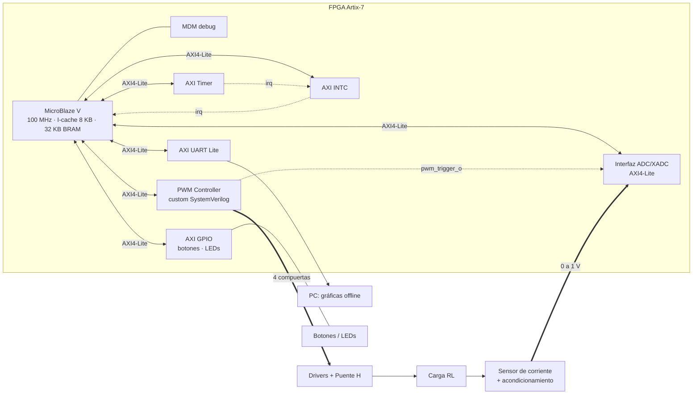

# Documento de diseño — Proyecto 4

**Control de corriente en un inversor monofásico mediante un regulador PR discreto sobre MicroBlaze V**

| | |
|---|---|
| Cursos | EL3313 Taller de Diseño Digital (TDD) · EL4201 Procesamiento Electrónico de Potencia (PEDP) |
| Semestre | II Semestre 2026 |
| Equipo | `[Pendiente]` |
| Grupo | `1` |

## Resumen

El sistema regula la corriente de una carga RL alimentada por un inversor monofásico en puente H, haciendo que siga una referencia sinusoidal de **50 Hz** con amplitudes de **0,2 / 0,5 / 1,0 A pico**.

Debido a la variedad de etapas, se referirán las cargas de la siguiente forma.
- **Hardware digital (TDD):** FPGA Artix-7 con MicroBlaze V a 100 MHz, un periférico PWM propio en SystemVerilog con interfaz AXI4-Lite, una interfaz ADC/XADC, AXI Timer, AXI UART Lite y AXI GPIO.
- **Software (TDD + PEDP):** una ISR periódica en C ejecuta el PR discreto y actualiza el PWM. Un buffer circular guarda las muestras y se exportan por UART al presionar un botón.
- **Potencia y control (PEDP):** puente H con MOSFET y drivers, carga RL, modelo en PLECS, diseño y discretización del PR.

### Reparto de responsabilidades

| Bloque | Responsable principal | Interfaz con el otro curso |
|---|---|---|
| Periférico PWM, ADC, drivers C, ISR, UART | TDD | Formato de `duty_ref`, periodo `Ts`, rango del ADC |
| Puente H, carga, sensor de corriente | PEDP | Niveles lógicos de las compuertas, escala V/A del sensor |
| Algoritmo PR (estructura, ganancias, ecuación en diferencias) | PEDP | Coeficientes y formato numérico entregados a TDD |
| Implementación del PR en el MicroBlaze V | TDD | Verificación contra el modelo PLECS |

---

## Objetivos y requisitos

### Requisitos de desempeño (criterios de aceptación)
| Métrica | Límite | Método de medición |
|---|---|---|
| Error de amplitud de la fundamental | ≤ 10 % | Ventana ≥ 5 periodos de 50 Hz; extracción por DFT/FFT con ventana entera de periodos |
|Rizado de conmutación pico a pico | ≤ 0,20 A | Ventana local; se resta la fundamental ajustada |
| Desfase de la fundamental | Solo se reporta | Fase de la DFT a 50 Hz, corriente vs. referencia |
| Jitter del periodo de control | `[PENDIENTE]` (objetivo < 1 µs) | Pin GPIO conmutado en la ISR, medido con osciloscopio |

---

## Arquitectura del sistema

### Diagrama de bloques general

### Mapa de memoria

Las direcciones finales las asigna el *Address Editor* de Vivado. Las siguientes son ilustrativas.

| Periférico | Base (ilustrativa) | Tamaño |
|---|---|---|
| AXI GPIO | `0x4000_0000` | 4 KB 
| AXI UART Lite | `0x4060_0000` | 4 KB 
| AXI INTC | `0x4120_0000` | 4 KB 
| AXI Timer | `0x41C0_0000` | 4 KB 
| PWM Controller | `0x44A0_0000` | 4 KB 
| ADC Interface | `0x44A1_0000` | 4 KB 

### Decisiones de arquitectura
Para un correcto desarrollo e implementación del proyecto, se seguirán las siguientes decisiones:
- Para simplificación y evitar cruces, se trabajará con el clock principal de la Basys 3 a 100 Mhz como entrada y otros relojes serán vía *Clocking Wizard* de Vivado
- Mediante IP integrados de Vivado serán configurados UART, GPIO y Timer, esto para centrarse en el pwm.
- Mediante XADC con AXI nativo, se desarrollará un ADC propio, permitiendo disparo por `pwm_trigger_o` y flag de dato nuevo

---

## Periférico PWM personalizado

### Objetivo y rol

Genera las cuatro señales de compuerta del puente H con **PWM unipolar** y **tiempo muerto configurable**, recibe la referencia de modulación por AXI4-Lite y emite `pwm_trigger_o` para sincronizar la conversión del ADC.

### Interfaz de señales

| Señal | Dir. | Ancho | Descripción |
|---|---|---|---|
| `aclk`, `aresetn` | in | 1 | Reloj y reset AXI |
| `s_axi_*` | in/out | — | Interfaz AXI4-Lite esclava completa (AW, W, B, AR, R) |
| `gate_ah_o`, `gate_al_o` | out | 1 | Compuertas high/low de la rama A |
| `gate_bh_o`, `gate_bl_o` | out | 1 | Compuertas high/low de la rama B |
| `pwm_trigger_o` | out | 1 | Pulso de un ciclo en el valle de la portadora |
| `fault_i` | in | 1 | Entrada de falla de hardware: apaga todas las compuertas |

### Mapa de registros

#### `CTRL` — offset `0x00` (R/W salvo bit 3)

| Bits | Campo | Acceso | Reset | Descripción |
|---|---|---|---|---|
| 0 | `enable` | R/W | 0 | Habilita la generación PWM |
| [2:1] | `freq_sel` | R/W | `01` | `00` = 5 kHz · `01` = 10 kHz · `10` = 20 kHz · `11` reservado (se trata como `01`) |
| 3 | `running` | RO | 0 | 1 cuando el generador está activo |
| [31:4] | — | RO | 0 | Reservado |

#### `DUTY` — offset `0x04`

| Bits | Campo | Acceso | Reset | Descripción |
|---|---|---|---|---|
| [15:0] | `duty_ref` | R/W | 0 | Referencia de modulación con signo (complemento a 2). Se satura a ±`MMAX` |
| [31:16] | — | RO | 0 | Reservado |

#### `DEADTIME` — offset `0x08` (extensión propuesta)

| Bits | Campo | Acceso | Reset | Descripción |
|---|---|---|---|---|
| [9:0] | `dead_cycles` | R/W | 75 | Tiempo muerto en ciclos de 10 ns (75 → 750 ns) |
| [31:10] | — | RO | 0 | Reservado |

## Referencias
- AMD, *MicroBlaze V Embedded Design Tutorial (UG1711)*.
- AMD, *Vivado Design Suite: Creating and Packaging Custom IP (UG1118)*.
- AMD, *AXI Reference Guide (UG1037)*.
- AMD, *7 Series FPGAs and Zynq-7000 SoC XADC Dual 12-Bit 1 MSPS ADC (UG480)*.
- AMD, *Vitis Unified Software Platform Documentation (UG1416)*