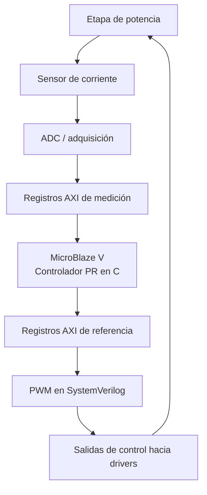
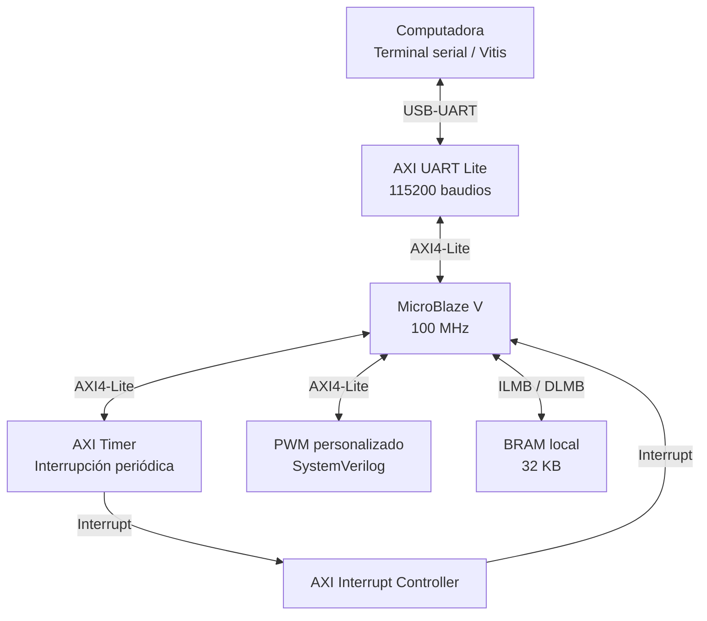
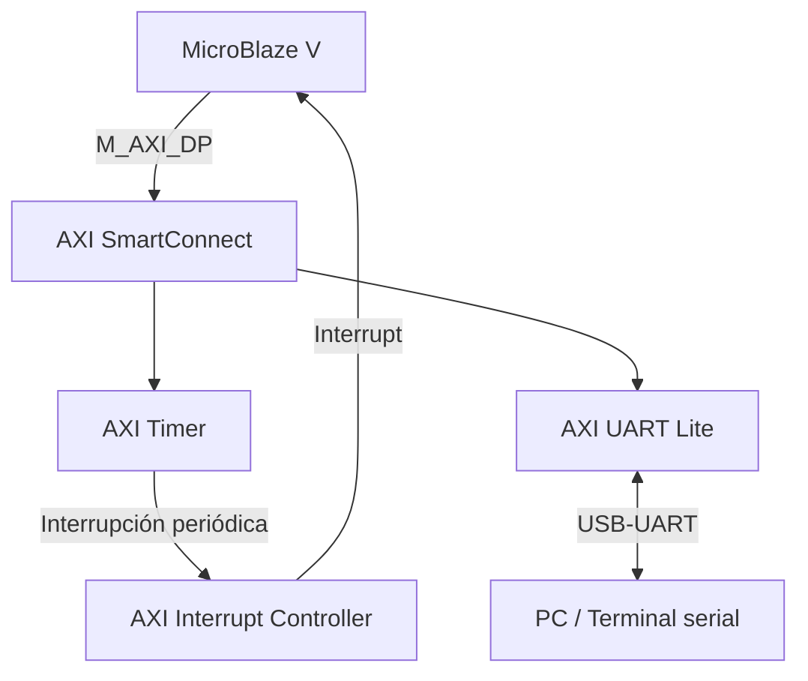
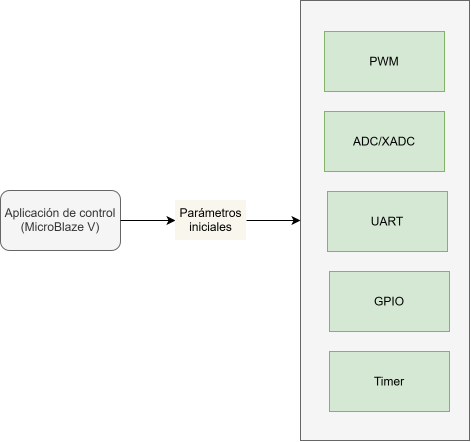
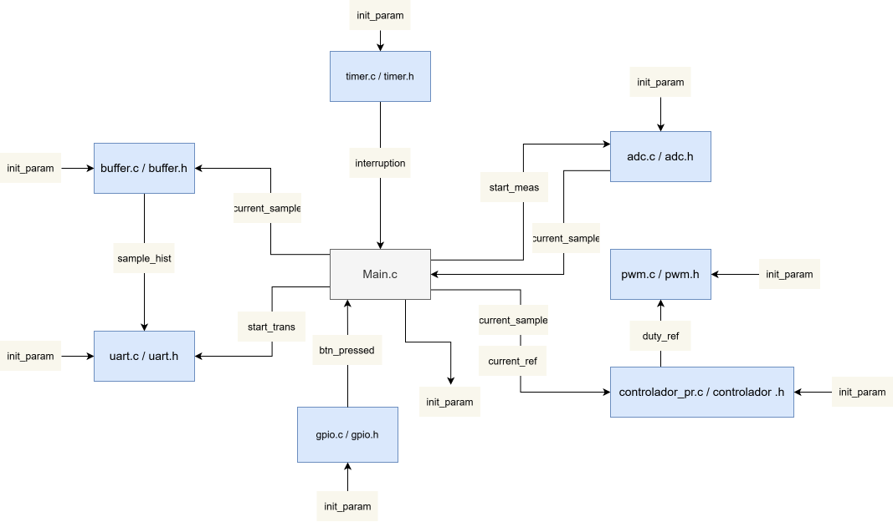

# Control de corriente en un inversor monofásico mediante un regulador PR discreto sobre MicroBlaze V

# 1. Introducción y objetivos

## 1.1. Introducción

El presente proyecto consiste en el diseño de un sistema digital embebido basado en el procesador MicroBlaze V, implementado sobre una FPGA Artix-7. El sistema tiene como propósito proporcionar una plataforma de procesamiento, adquisición de datos y generación de señales de control para un inversor monofásico en puente H, encargado de regular la corriente de una carga RL mediante un controlador proporcional-resonante (PR) discreto.

Desde la perspectiva de Taller de Diseño Digital, el proyecto contempla la integración del procesador MicroBlaze V con diferentes periféricos mediante interfaces AXI4-Lite. Entre estos se encuentran un generador PWM personalizado desarrollado en SystemVerilog, una interfaz de adquisición ADC/XADC, un temporizador para la ejecución periódica del control y módulos de comunicación UART y GPIO.

La arquitectura propuesta distribuye las funciones entre hardware y software. Los periféricos digitales se encargan de las operaciones de adquisición, generación de señales y comunicación, mientras que el procesador ejecuta el programa de control desarrollado en C. Esta distribución permite implementar un sistema modular, cuyos componentes pueden diseñarse, verificarse e integrarse progresivamente.

El desarrollo de la plataforma digital se realiza en coordinación con el sistema de potencia, responsable de proporcionar las condiciones de operación del inversor y los parámetros del controlador PR. De esta manera, el diseño digital se concentra en la implementación de la lógica de control y las interfaces necesarias para su integración con la etapa de potencia.

## 1.2. Objetivo general

Diseñar un sistema digital embebido basado en MicroBlaze V, integrando periféricos mediante interfaces AXI4-Lite y módulos personalizados en SystemVerilog, para implementar la adquisición de corriente, la ejecución periódica de un controlador PR discreto y la generación de señales PWM destinadas al control de un inversor monofásico.

## 1.3. Objetivos específicos

1. Definir una arquitectura modular basada en MicroBlaze V que integre memoria, periféricos de comunicación, temporización y módulos personalizados mediante interfaces AXI.

2. Diseñar un periférico PWM personalizado en SystemVerilog, con modulación unipolar, tiempo muerto configurable, selección de frecuencias de conmutación e interfaz AXI4-Lite.

3. Establecer un sistema de adquisición de datos mediante ADC/XADC que permita obtener muestras de corriente sincronizadas con la generación de señales PWM.

4. Diseñar la estructura del software embebido en C para gestionar las interrupciones periódicas, ejecutar el algoritmo de control PR, actualizar los registros del PWM y almacenar las muestras adquiridas.

5. Definir un mecanismo de comunicación UART que permita transmitir a una computadora el historial de muestras almacenadas, mediante una solicitud realizada desde la FPGA.

6. Establecer una estrategia de verificación basada en simulaciones, testbenches autoverificables y pruebas funcionales en FPGA para comprobar los módulos digitales y su integración.

## 2. Requisitos del sistema

El sistema deberá cumplir con los siguientes requisitos:

1. **Etapa de potencia:** inversor monofásico en puente H, alimentado entre 12 y 24 V DC, con una carga RL dimensionada y justificada.

2. **Referencia de corriente:** seguimiento de una señal sinusoidal de 50 Hz, con amplitudes de 0,2 A, 0,5 A y 1,0 A pico.

3. **Control PWM:** implementación de un regulador PR discreto y generación de modulación PWM unipolar con tiempo muerto configurable.

4. **Adquisición y comunicación:** medición de corriente sincronizada con el PWM y comunicación entre periféricos mediante registros AXI4-Lite.

5. **Sistema embebido:** procesador MicroBlaze V a 100 MHz, con 32 KB de memoria local, 8 KB de caché de instrucciones y ejecución periódica mediante interrupciones.

6. **Periférico personalizado:** desarrollo de un controlador PWM en SystemVerilog, con interfaz AXI4-Lite y al menos tres frecuencias de conmutación seleccionables.

Los parámetros de conmutación, muestreo y control deberán definirse y justificarse de acuerdo con las condiciones de operación del sistema.

## 3. Arquitectura y diseño de hardware

### 3.1. Arquitectura general

El sistema se desarrolla sobre una FPGA Artix-7 mediante una arquitectura modular basada en el procesador MicroBlaze V. Este se encarga de ejecutar el software de control en C y administrar los periféricos digitales mediante interfaces AXI4-Lite.

La arquitectura incorpora memoria BRAM para el almacenamiento de instrucciones y datos, un temporizador para generar interrupciones periódicas, una interfaz UART para transmitir información y módulos de adquisición y generación PWM.

El funcionamiento general consiste en adquirir una muestra de corriente mediante el ADC/XADC, procesarla utilizando el controlador PR discreto y actualizar el periférico PWM para generar las señales de actuación correspondientes.

### 3.2. Módulos del sistema

Los principales componentes de la arquitectura digital y sus funciones se presentan a continuación.

### 3.3. Diagramas del sistema

## Diagramas generales del sistema
### Nivel 1

### Nivel 2

### Nivel 3

| Módulo | Función |
|---|---|
| MicroBlaze V | Ejecuta el programa de control y administra los periféricos. |
| Memoria BRAM y caché | Almacenan instrucciones y datos y permiten optimizar el acceso a instrucciones. |
| AXI SmartConnect | Interconecta el procesador con los periféricos mediante AXI. |
| AXI Timer | Genera la base temporal del control periódico. |
| AXI Interrupt Controller | Gestiona las interrupciones dirigidas al procesador. |
| AXI UART Lite | Permite transmitir las muestras almacenadas hacia una computadora. |
| AXI GPIO | Gestiona los botones y los indicadores de estado. |
| ADC/XADC | Adquiere las mediciones de corriente. |
| PWM personalizado | Genera la modulación unipolar con tiempo muerto configurable. |
| MDM | Permite depurar el sistema embebido. |

Cada módulo se integra a la arquitectura mediante interfaces definidas, permitiendo su desarrollo y verificación individual antes de la integración completa.

### Flujo de control de corriente
Este diagrama representa el recorrido de la señal en el lazo de control: se mide la corriente de la etapa de potencia, se convierte y se entrega al MicroBlaze V mediante registros AXI. El procesador calcula la acción de control PR, actualiza la referencia del PWM y este genera las señales para los drivers del puente H.

### Arquitectura general del sistema digital
Este diagrama muestra los bloques principales del sistema y su comunicación: el MicroBlaze V usa la BRAM para programa y datos, accede al temporizador y al PWM por AXI4-Lite, y se comunica con la computadora mediante UART. El temporizador genera la interrupción que permite ejecutar periódicamente el control.

#### Interconexión y temporización del AXI Timer
Este diagrama detalla cómo el MicroBlaze V se comunica con el temporizador y la UART a través de AXI SmartConnect. La interrupción del temporizador se dirige al controlador de interrupciones y luego al procesador para marcar la ejecución periódica.

## Diseño de software
La aplicación embebida en C ejecuta el lazo de control mediante interrupciones periódicas: adquiere la corriente, calcula la acción del PR y actualiza la referencia del PWM. También gestiona la solicitud de exportación del historial de muestras por UART. 

La aplicación de control cuenta con tres etapas:
- Inicialización: MicroBlaze V configura los parámetros iniciales de los periféricos y queda a la espera de la interrupción del Timer.
  

  

- Interrupción periódica: El Timer define un periodo de muestreo en el que en cada instante de muestra se verifica la disponibilidad del dato, se lee el dato y se configura el controlador Proporcional-Resonante para la actualización del PWM.
- Historial de datos: Al presionar un botón el sistema se encarga de enviar vía UART un historial de muestras previamente almacenadas en un buffer circular.

#### Diagrama
En la Figura se muestra la arquitectura modular del software en C, con las señales que intercambian los módulos. El módulo main.c coordina los drivers de los periféricos (timer, ADC, PWM, UART y GPIO), el buffer de muestras y el controlador PR, mediante llamadas a sus funciones y el intercambio de datos. El flujo de control lo inicia la interrupción periódica del temporizador, que ejecuta en cada periodo la adquisición, el cálculo del control y la actualización del PWM.

  

Las siguientes entradas y salidas se denotan respecto a `main.c`:
##### Entradas
- `Interruption`: interrupción periódica del timer.
- `btn_pressed`: señal de botón presionado.
- `init_param`: señales con parámetros iniciales para cada modulo durante la etapa de inicialización. 
##### Salidas 
- `current_sample`: muestra de la medición de corriente medida por el ADC/XADC.
- `start_meas`: señal que indica el inicio de la medición a el ADC cada interrupción de periodo.
- `current_ref`: referencia de corriente necesaria para el controlador.
- `start_trans`: indica a la UART el inicio de la transmisión.
- `sample_hist`: historial de muestras almacenado en el buffer circular.
- `duty_ref`: señal de corrección para el PWM.

##### Código modular
En lenguaje C, la programación modular significa que el código se realiza en pequeñas partes reusables. Para esto se dividen en archivos .h (header files), en los cuales se declara interfaz, y los .c (source files), en donde se realiza la implementación. Esta organización favorece la reutilización de una misma interfaz en otras partes del código y la modificación de la implementación sin afectar otras partes del código [1].  

## Integración del sistema
La integración conecta el procesador con los periféricos mediante AXI4(-Lite), sincroniza la adquisición de corriente con el PWM y enlaza las señales de actuación con la etapa de potencia. La arquitectura modular permite verificar cada periférico antes de integrar el lazo completo.
## 6. Estrategia de implementación y validación

### 6.1. Metodología de implementación

El desarrollo del sistema se realizará mediante una metodología incremental, permitiendo verificar el funcionamiento de cada módulo antes de integrarlo con los demás componentes.

Se establecen las siguientes fases:

1. **Configuración del sistema base:** implementación del procesador MicroBlaze V, memoria, reloj e interfaces de comunicación en Vivado, verificando su funcionamiento mediante un programa de prueba en Vitis.

2. **Desarrollo de periféricos:** configuración de los módulos AXI Timer, UART y GPIO, además del diseño del controlador PWM personalizado en SystemVerilog y la interfaz ADC/XADC.

3. **Integración de hardware:** conexión de los periféricos mediante AXI4-Lite, asignación de direcciones y verificación de las operaciones de lectura y escritura.

4. **Desarrollo del software:** implementación en C de las interrupciones periódicas, adquisición de corriente, ejecución del controlador PR, actualización del PWM y almacenamiento y transmisión de muestras.

5. **Validación del sistema:** ejecución de simulaciones y pruebas funcionales para verificar la comunicación entre módulos, la temporización y el funcionamiento integrado.

### 6.2. Estrategia de verificación

La verificación del sistema se realizará mediante simulaciones en Vivado, testbenches autoverificables y pruebas funcionales sobre la FPGA.

Se contemplan las siguientes pruebas:

| Módulo | Prueba de verificación |
|---|---|
| MicroBlaze V | Comprobar la ejecución de software y la comunicación con los periféricos. |
| PWM personalizado | Verificar las tres frecuencias de conmutación, modulación unipolar, tiempo muerto y habilitación. |
| Interfaz AXI4-Lite | Comprobar la lectura y escritura de registros, estados y saturación de referencias. |
| ADC/XADC | Verificar la adquisición de muestras y su sincronización con el PWM. |
| AXI Timer | Comprobar la generación periódica de interrupciones y medir el período efectivo y su jitter. |
| UART y GPIO | Verificar la transmisión de muestras almacenadas al presionar un botón. |
| Sistema integrado | Comprobar la ejecución coordinada de adquisición, procesamiento y actualización del PWM. |

### 6.3. Criterios de validación

El periférico PWM contará con un testbench autoverificable que permita comprobar automáticamente las condiciones de funcionamiento y reportar los resultados de cada prueba.

Se verificará especialmente que las señales complementarias respeten el tiempo muerto establecido, que las referencias fuera de rango sean saturadas correctamente y que la señal `pwm_trigger_o` permita sincronizar la adquisición.

Adicionalmente, se realizará una simulación temporizada posterior a la implementación del periférico personalizado.

### Bibliografía
[1] W3Schools, "C Organize Code," W3Schools. [En línea]. Disponible en: https://www.w3schools.com/c/c_organize_code.php. [Accedido: 03-Nov-2026]

La validación final comprobará que los periféricos se comuniquen correctamente con MicroBlaze V, que las interrupciones mantengan la periodicidad requerida y que la transmisión UART no interfiera con la ejecución del lazo de control.
