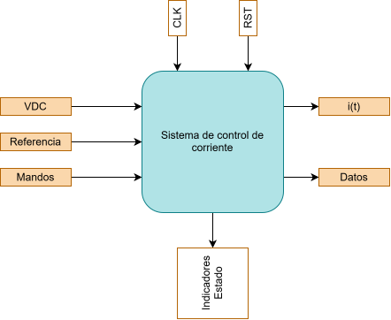
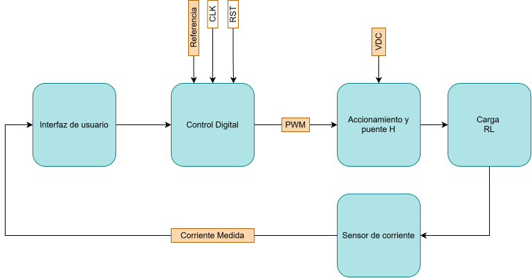
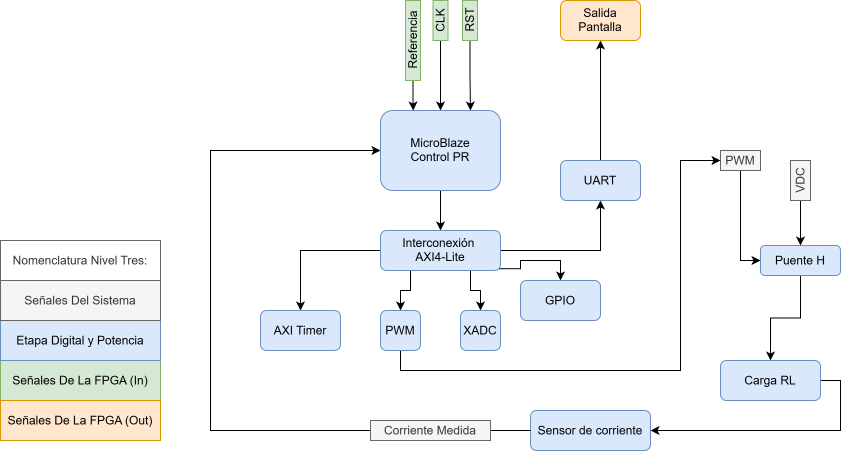
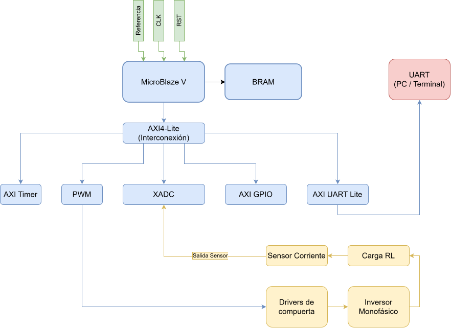
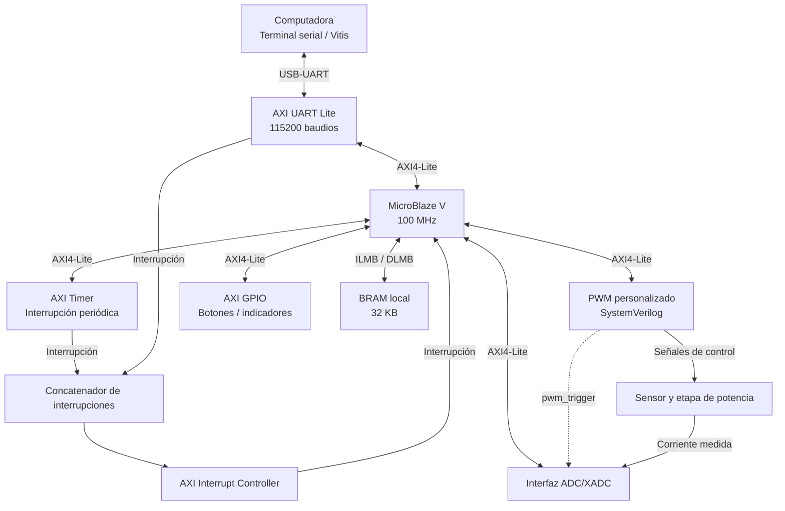
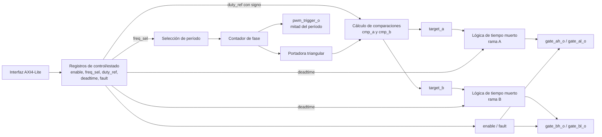
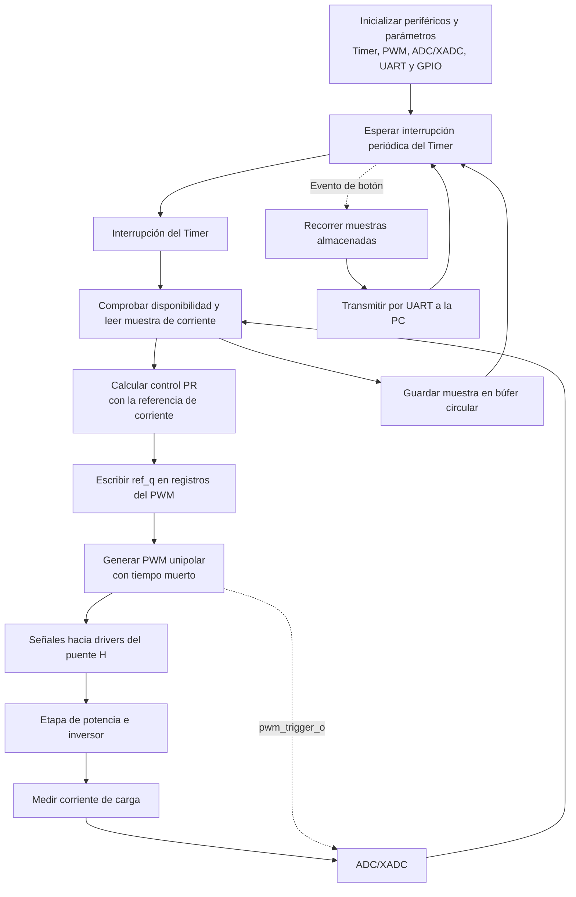

# Control de corriente en un inversor monofásico mediante un regulador PR discreto sobre MicroBlaze V

## 1. Introducción y objetivos

### 1.1. Introducción

El presente proyecto consiste en el diseño de un sistema digital embebido basado en el procesador MicroBlaze V, implementado sobre una FPGA Artix-7. El sistema tiene como propósito proporcionar una plataforma de procesamiento, adquisición de datos y generación de señales de control para un inversor monofásico en puente H, encargado de regular la corriente de una carga RL mediante un controlador proporcional-resonante (PR) discreto.

La arquitectura propuesta distribuye las funciones entre hardware y software. Los periféricos digitales se encargan de las operaciones de adquisición, generación de señales y comunicación, mientras que el procesador ejecuta el programa de control desarrollado en C. Esta distribución permite implementar un sistema modular, cuyos componentes pueden diseñarse, verificarse e integrarse progresivamente.

### 1.2. Objetivo general

Diseñar un sistema digital embebido basado en MicroBlaze V, integrando periféricos mediante interfaces AXI4-Lite y módulos personalizados en SystemVerilog, para implementar la adquisición de corriente, la ejecución periódica de un controlador PR discreto y la generación de señales PWM destinadas al control de un inversor monofásico.

### 1.3. Objetivos específicos

1. Definir una arquitectura modular basada en MicroBlaze V que integre memoria, periféricos de comunicación, temporización y módulos personalizados mediante interfaces AXI.

2. Diseñar un periférico PWM personalizado en SystemVerilog, con modulación unipolar, tiempo muerto configurable, selección de frecuencias de conmutación e interfaz AXI4-Lite.

3. Establecer un sistema de adquisición de datos mediante ADC/XADC que permita obtener muestras de corriente sincronizadas con la generación de señales PWM.

4. Diseñar la estructura del software embebido en C para gestionar las interrupciones periódicas, ejecutar el algoritmo de control PR, actualizar los registros del PWM y almacenar las muestras adquiridas.

5. Definir un mecanismo de comunicación UART que permita transmitir a una computadora el historial de muestras almacenadas, mediante una solicitud realizada desde la FPGA.

6. Establecer una estrategia de verificación basada en simulaciones, testbenches autoverificables y pruebas funcionales en FPGA para comprobar los módulos digitales y su integración.

## 2. Requisitos del sistema

El sistema deberá cumplir con los siguientes requisitos:

1. **Etapa de potencia:** inversor monofásico en puente H, alimentado entre 12 y 24 V DC, con una carga RL dimensionada y justificada.

2. **Referencia de corriente:** seguimiento de una señal sinusoidal de 50 Hz, con amplitudes de 0,2 A, 0,5 A y 1,0 A pico.

3. **Control PWM:** implementación de un regulador PR discreto y generación de modulación PWM unipolar con tiempo muerto configurable.

4. **Adquisición y comunicación:** medición de corriente sincronizada con el PWM y comunicación entre periféricos mediante registros AXI4-Lite.

5. **Sistema embebido:** procesador MicroBlaze V a 100 MHz, con 32 KB de memoria local, 8 KB de caché de instrucciones y ejecución periódica mediante interrupciones.

6. **Periférico personalizado:** desarrollo de un controlador PWM en SystemVerilog, con interfaz AXI4-Lite y al menos tres frecuencias de conmutación seleccionables.

Los parámetros de conmutación, muestreo y control deberán definirse y justificarse de acuerdo con las condiciones de operación del sistema.

## 3. Arquitectura y diseño de hardware

### 3.1. Arquitectura general

La arquitectura propuesta se basa en el procesador MicroBlaze V sobre una FPGA Artix-7. El procesador ejecuta el software de control en C y administra los periféricos digitales mediante interfaces AXI4-Lite [2].

La arquitectura contempla memoria BRAM para el almacenamiento de instrucciones y datos, un temporizador para generar interrupciones periódicas, una interfaz UART para transmitir información y módulos de adquisición y generación PWM.

El funcionamiento previsto consiste en adquirir una muestra de corriente mediante el ADC/XADC, procesarla utilizando el controlador PR discreto y actualizar el periférico PWM para generar las señales de actuación correspondientes.

### 3.2. Módulos del sistema

La tabla resume los bloques de la arquitectura descrita para el sistema y la función asignada a cada uno.

| Módulo | Función en el sistema |
|---|---|
| MicroBlaze V | Ejecuta el software embebido y administra los periféricos. |
| BRAM local y caché de instrucciones | Almacenan el programa y los datos del sistema; la caché mejora el acceso a instrucciones. |
| AXI SmartConnect | Interconecta el procesador y los periféricos accesibles mediante AXI. |
| AXI Timer y AXI Interrupt Controller | El Timer genera interrupciones periódicas y el controlador de interrupciones las entrega al procesador. |
| AXI UART Lite | Permite la comunicación serial de diagnóstico; está prevista para transmitir el historial de muestras. |
| AXI GPIO | Permitirá leer botones y controlar indicadores de estado; su integración está pendiente. |
| Interfaz ADC/XADC | El XADC Wizard está integrado para adquirir señales por VAUX6; falta completar su uso desde el programa principal. |
| PWM personalizado | Módulo desarrollado en SystemVerilog para generar modulación unipolar y señales complementarias con tiempo muerto; falta integrarlo al Block Design. |
| MDM | Proporciona la interfaz de depuración del sistema embebido. |

La arquitectura permite desarrollar y verificar los módulos individualmente y luego integrarlos mediante las interfaces definidas. Actualmente se ha comprobado el funcionamiento del sistema base, incluyendo el AXI Timer y la comunicación UART; el control PR, la utilización del XADC desde el programa principal y el acceso al PWM mediante AXI4-Lite siguen pendientes.

### 3.3. Diagramas del sistema

#### 3.3.1. Diagramas generales del sistema

##### 3.3.1.1. Nivel 1

##### 3.3.1.2. Nivel 2

##### 3.3.1.3. Nivel 3

##### 3.3.1.4. Nivel 4: arquitectura digital y etapa de potencia

DN4 desglosa el bloque de control digital y muestra su relación con los elementos externos. MicroBlaze V accede a la memoria y a los periféricos por sus buses correspondientes; AXI UART Lite comunica el sistema con la computadora; el PWM proporcionará las señales de actuación; y la medición de corriente se plantea mediante el XADC. La figura representa la arquitectura funcional propuesta, no todas las conexiones ni el estado de integración actual en Vivado. En el Block Design disponible están MicroBlaze V, la memoria, AXI Timer, AXI Interrupt Controller, XADC y AXI UART Lite; el AXI GPIO y el periférico PWM personalizado aún no aparecen integrados allí. Tampoco se muestra en DN4 el controlador de interrupciones ni se ha establecido en el Block Design la conexión de `pwm_trigger_o` al disparo del XADC.

#### 3.3.2. Arquitectura general del sistema digital

El siguiente diagrama resume la arquitectura digital propuesta [3] y las relaciones funcionales entre sus bloques. MicroBlaze V accede a la memoria local por los buses LMB y a los periféricos por AXI4-Lite; el controlador de interrupciones permite atender los eventos de los periféricos; el PWM generará las señales de actuación y se propone usar su disparo para sincronizar la adquisición; la UART enlaza el sistema con la computadora. La presencia de un bloque en esta arquitectura propuesta no implica que ya esté integrado en el Block Design actual.

#### 3.3.3. Interconexión y temporización del AXI Timer

El sistema utiliza un reloj de 100 MHz para el procesador MicroBlaze V y sus periféricos. La temporización periódica se implementa mediante el AXI Timer, configurado con un valor de recarga de 99999 ciclos, equivalente a un período nominal de 1 ms.

Por otra parte, el periférico PWM contempla tres frecuencias de conmutación configurables:

| Frecuencia PWM | Período |
|---|---|
| 10 kHz | 100 µs |
| 12,5 kHz | 80 µs |
| 20 kHz | 50 µs |

El AXI Timer y el PWM cumplen funciones diferentes. El primero genera interrupciones periódicas para el software, mientras que el segundo genera las señales de modulación mediante lógica dedicada.

El diseño contempla utilizar la señal `pwm_trigger_o` para sincronizar la adquisición del XADC con la modulación PWM. Esta sincronización permanece pendiente de integración y verificación.

#### 3.3.4. Diagrama interno del PWM personalizado

A continuación se presenta la descomposición funcional del periférico PWM personalizado.

**a) Nombre del módulo:** PWM unipolar con AXI4-Lite.

**b) Diagrama modular**

El diagrama resume la implementación RTL: los registros AXI configuran la frecuencia, la referencia y el tiempo muerto; la portadora triangular y las comparaciones producen las órdenes de conmutación de las dos ramas, que pasan por la lógica de tiempo muerto. La señal `pwm_trigger_o` se genera en la mitad del período, y la habilitación y la falla controlan las salidas.

**c) Objetivo del módulo**

El periférico actúa como elemento de salida digital del lazo de control. Convierte la referencia calculada por el controlador PR, ejecutado por MicroBlaze V, en señales para los drivers del puente H. El objetivo del lazo es regular la corriente de la carga RL para que siga la referencia sinusoidal de 50 Hz.

Una vez integrado el periférico, el software escribirá por AXI4-Lite la referencia de modulación `ref_q` en formato Q1.15, normalizada aproximadamente entre −1 y 1. El PWM genera la modulación unipolar y aplica un tiempo muerto configurable a cada rama para evitar la conducción simultánea de los dos transistores de esa rama. En el modelo ideal, la componente promedio de la tensión diferencial aplicada a la carga es proporcional a `Vdc · ref`; el rizado depende de la estrategia de modulación y de la frecuencia de conmutación. Los registros y sus offsets se detallan en la sección 4.3.

La señal `pwm_trigger_o` produce un pulso por período, en el centro de la portadora, y se propone utilizarla para sincronizar el muestreo del XADC. Ante `fault_i` o la deshabilitación, las cuatro salidas de compuerta se fuerzan a cero; `running` permite consultar el estado del periférico. La conexión del disparo y la señal de falla con sus fuentes externas deben completarse en la integración del sistema.

**d) Entradas**

| Señal | Descripción |
|---|---|
| aclk | Reloj del sistema, 100 MHz. |
| aresetn | Reset síncrono, activo en bajo. |
| s_axi_awaddr | Dirección de escritura (offset en bytes). |
| s_axi_awprot | Atributos AXI. Se ignoran. |
| s_axi_awvalid | Dirección de escritura válida. |
| s_axi_wdata | Dato de escritura |
| s_axi_wstrb | Habilitación por byte del dato de escritura. |
| s_axi_wvalid | Dato de escritura válido. |
| s_axi_bready | El master acepta la respuesta de escritura. |
| s_axi_araddr | Dirección de lectura (offset en bytes). |
| s_axi_arprot | Atributos AXI. Se ignoran. |
| s_axi_arvalid | Dirección de lectura válida. |
| s_axi_rready | El master acepta el dato de lectura. |
| fault_i | Señal externa de falla, activa en alto; por ejemplo, una condición de sobrecorriente detectada por un circuito de protección. |

**e) Salidas**

| Señal | Descripción |
|---|---|
| s_axi_awready | El esclavo acepta la dirección de escritura. |
| s_axi_wready | El esclavo acepta el dato de escritura. |
| s_axi_bresp | Respuesta de escritura: 00 OKAY, 10 SLVERR. |
| s_axi_bvalid | Respuesta de escritura válida. |
| s_axi_arready | El esclavo acepta la dirección de lectura. |
| s_axi_rdata | Dato de lectura. |
| s_axi_rresp | Respuesta de lectura: 00 OKAY, 10 SLVERR. |
| s_axi_rvalid | Dato de lectura válido. |
| gate_ah_o | Compuerta del transistor superior de la rama A. |
| gate_al_o | Compuerta del transistor inferior de la rama A. |
| gate_bh_o | Compuerta del transistor superior de la rama B. |
| gate_bl_o | Compuerta del transistor inferior de la rama B. |
| pwm_trigger_o | Pulso de 1 reloj, una vez por período, hacia el ADC. |

**f) Relación con otros módulos**

| Módulo | Señales | Relación |
|---|---|---|
| MicroBlaze V, por AXI SmartConnect | `s_axi_*` | Una vez integrado el periférico al Block Design, el software podrá configurar `enable`, `freq_sel` y `deadtime`, escribir `ref_q` y consultar el estado de funcionamiento mediante AXI4-Lite. |
| AXI Timer | Ninguna directa | La relación es por software. El AXI Timer genera interrupciones periódicas de 1 ms, mientras que el PWM opera independientemente a 10 kHz, 12,5 kHz o 20 kHz. La coordinación temporal entre ambos debe definirse durante la implementación del lazo de control. |
| AXI UART Lite | Ninguna directa | El PWM no genera interrupciones hacia la UART. El software puede consultar el estado de falla y reflejarlo en un indicador mediante GPIO, cuando ese periférico esté integrado. |
| XADC | `pwm_trigger_o` → entrada de disparo de conversión | Se propone un pulso por período de conmutación para iniciar la adquisición cerca del centro de la portadora. Esta conexión no está presente en el Block Design actual. |

## 4. Interfaces y comunicación

### 4.1. Comunicación mediante AXI4-Lite

MicroBlaze V actúa como maestro AXI y accede a los periféricos por medio de AXI SmartConnect. AXI4-Lite organiza las transacciones en cinco canales [4]:

| Canal | Función |
|---|---|
| AW | Dirección de escritura |
| W | Datos de escritura |
| B | Respuesta de escritura |
| AR | Dirección de lectura |
| R | Datos y respuesta de lectura |

Cada periférico se localiza mediante una dirección base asignada en el Address Editor de Vivado; sus registros se identifican mediante offsets relativos a esa dirección.

### 4.2. Mapa de memoria

El procesador MicroBlaze V se comunica con los periféricos mediante el bus AXI4-Lite. Cada periférico dispone de un espacio de direcciones que permite acceder a sus registros de configuración, control y estado.

La asignación de direcciones de los periféricos integrados en el Block Design, junto con el PWM previsto, es la siguiente:

| Periférico | Dirección base | Función |
|---|---|---|
| AXI UART Lite | `0x40600000` | Comunicación serial |
| AXI Interrupt Controller | `0x41200000` | Gestión de interrupciones |
| AXI Timer | `0x41C00000` | Temporización periódica |
| XADC Wizard | `0x44A00000` | Adquisición de señales analógicas |
| PWM AXI4-Lite | Por asignar | Generación de señales PWM |

El periférico PWM se encuentra desarrollado en SystemVerilog, pero su dirección base se establecerá cuando sea integrado al Block Design.

Las direcciones permiten que el software acceda a los periféricos mediante operaciones de lectura y escritura sobre registros mapeados en memoria.

### 4.3. Registros del periférico PWM

El RTL de `pwm_axi_lite.sv` define los registros siguientes. Los offsets son relativos a la dirección base del periférico. La guía de Vivado para empaquetar IP personalizado se cita en [5].

| Offset | Campo | Acceso | Bits | Función |
|---|---|---|---|---|
| `0x00` | `enable` | R/W | `[0]` | Habilita la generación PWM. |
| `0x00` | `freq_sel` | R/W | `[2:1]` | Selecciona 10, 12.5 o 20 kHz; el selector `2'b11` no es válido. |
| `0x00` | `running` | RO | `[3]` | Indica que el generador está activo y no está inhibido por una falla. |
| `0x04` | `ref_q` | R/W | `[15:0]` | Referencia de modulación con signo en formato Q1.15; se limita al intervalo de −32767 a 32767. |
| `0x08` | `deadtime_q` | R/W | `[7:0]` | Tiempo muerto en ciclos de reloj, limitado a 1–100; valor inicial 20. |
| `0x0C` | `fault_latched` | RO | `[0]` | Indica una falla enclavada; se borra al deshabilitar el PWM. |
| `0x0C` | `fault_i` | RO | `[1]` | Refleja la entrada de falla actual. |

Los demás bits de estos registros están reservados. El RTL responde con `SLVERR` ante direcciones de registro no implementadas y ante el selector de frecuencia reservado.

### 4.4. Señales de entrada y salida

Las señales del periférico PWM corresponden a su interfaz RTL. Las señales de ADC/XADC, Timer, UART y GPIO resumen las funciones requeridas para la arquitectura del sistema; la adquisición XADC se describe en la guía del dispositivo [6].

| Módulo | Entradas | Salidas | Función |
|---|---|---|---|
| PWM personalizado | `aclk`, `aresetn`, canales AXI4-Lite, `fault_i` | Canales de respuesta AXI, `gate_ah_o`, `gate_al_o`, `gate_bh_o`, `gate_bl_o`, `pwm_trigger_o` | Genera la modulación; su disparo está previsto para sincronizar la adquisición. Aún no está integrado al Block Design. |
| ADC/XADC | Entrada analógica VAUX6; disparo externo previsto | Muestras digitales accesibles por AXI | Adquisición analógica mediante XADC Wizard; la sincronización con el PWM aún no está conectada. |
| AXI Timer | Acceso AXI y reloj/reset | `interrupt` | Genera interrupciones periódicas; actualmente se ha probado con un período nominal de 1 ms. |
| AXI UART Lite | Datos y control por AXI; recepción serial | Transmisión serial | Permite mensajes de diagnóstico; el envío del historial está previsto. |
| AXI GPIO | Lectura de botones | Control de indicadores | Permitirá solicitar la exportación e indicar estados del sistema; pendiente de integración. |

### 4.5. Interconexión y sincronización

AXI4-Lite sirve para configurar y consultar los periféricos. Actualmente, la interrupción del AXI Timer [7] llega a MicroBlaze V a través del AXI Interrupt Controller y se utiliza para comprobar la ejecución periódica del software. En la arquitectura completa, se propone que `pwm_trigger_o` sincronice la adquisición del XADC con el período PWM; posteriormente, el procesador leerá la muestra y escribirá la referencia calculada en el registro del PWM. La UART, utilizada por ahora para diagnóstico, también permitirá transmitir el historial hacia la computadora [8]. Estas funciones del lazo de control aún requieren integración y validación.

## 5. Funcionamiento e integración

### 5.1. Funcionamiento del software

En la versión implementada, el software inicializa el AXI Timer, configura una interrupción nominal cada 1 ms y envía mensajes de diagnóstico por UART. La rutina de interrupción incrementa un contador que consulta el programa principal. Aunque se dispone de archivos para manejar el XADC, su lectura aún no forma parte de `main.c`, y el controlador PR y el acceso al PWM todavía no están implementados.

El flujo previsto para completar la aplicación embebida en C comprende estas etapas:

1. **Inicialización:** MicroBlaze V configurará el Timer, PWM, ADC/XADC, UART y GPIO, y establecerá los parámetros iniciales de operación.
2. **Adquisición:** en la arquitectura propuesta, `pwm_trigger_o` inicia una conversión del XADC por período PWM. La conversión debe completarse antes de que el software utilice la muestra.
3. **Ejecución periódica:** la interrupción del AXI Timer notifica al procesador que debe ejecutar el ciclo de control. La rutina comprueba que la muestra esté disponible, la lee, calcula la ley PR y actualiza `ref_q` en el PWM. El período del Timer y la secuencia de adquisición deben coordinarse para que se procese la muestra correspondiente a cada iteración.
4. **Almacenamiento:** cada muestra se guarda en un búfer circular para mantener el historial.
5. **Exportación:** ante un evento del botón, el sistema recorre el historial y transmite las muestras por UART a la computadora.

### 5.2. Integración del sistema

El siguiente diagrama organiza el ciclo de control previsto: `pwm_trigger_o` inicia la conversión y el XADC entrega la muestra; la interrupción periódica del Timer agenda el procesamiento en MicroBlaze V; la referencia calculada actualiza el PWM. La solicitud del botón permite exportar el historial sin formar parte de la secuencia periódica. La coordinación entre el fin de conversión y la rutina periódica debe garantizarse en el software. El diagrama es una representación funcional de la solución propuesta y no implica que el lazo completo ya esté operativo.

## 6. Estrategia de implementación y validación

### 6.1. Metodología de implementación

El desarrollo del sistema sigue una metodología incremental que permite verificar el funcionamiento de cada módulo antes de integrarlo con los demás componentes. Algunas fases ya cuentan con resultados y otras permanecen pendientes.

Se establecen las siguientes fases:

1. **Configuración del sistema base:** se configuraron MicroBlaze V, memoria, reloj e interfaces de comunicación en Vivado. Se validó el diseño base y se completaron la síntesis, la implementación y la generación del bitstream, además de una prueba de ejecución en Vitis.

2. **Desarrollo de periféricos:** se configuraron AXI Timer, UART y XADC Wizard, y se desarrolló el controlador PWM personalizado en SystemVerilog junto con su testbench. El AXI GPIO continúa pendiente.

3. **Integración de hardware:** se conectaron los periféricos del sistema base mediante AXI y se asignaron sus direcciones. Falta incorporar el PWM personalizado, asignarle una dirección base y completar las señales de sincronización.

4. **Desarrollo del software:** se implementó en C la inicialización del Timer, la atención de interrupciones y la comunicación UART de diagnóstico. Permanecen pendientes la adquisición de corriente desde `main.c`, el controlador PR, la actualización del PWM y el almacenamiento y la transmisión del historial de muestras.

5. **Validación del sistema:** se verificó el funcionamiento básico del procesador, el Timer y la UART. Se deberán documentar los resultados de las simulaciones del PWM y efectuar pruebas del sistema completamente integrado.

### 6.2. Estrategia de verificación

La verificación del sistema combina simulaciones en Vivado, testbenches autoverificables y pruebas funcionales sobre la FPGA. Las pruebas del sistema base no sustituyen la validación de los periféricos que aún no se han integrado.

Se contemplan las siguientes pruebas:

| Módulo | Prueba de verificación |
|---|---|
| MicroBlaze V | Comprobar la ejecución de software y la comunicación con los periféricos. |
| PWM personalizado | Verificar las tres frecuencias de conmutación, modulación unipolar, tiempo muerto y habilitación. |
| Interfaz AXI4-Lite | Comprobar la lectura y escritura de registros, estados y saturación de referencias. |
| ADC/XADC | Verificar la adquisición de muestras y su sincronización con el PWM. |
| AXI Timer | Comprobar la generación periódica de interrupciones y medir el período efectivo y su jitter. |
| UART y GPIO | Verificar la transmisión de muestras almacenadas al presionar un botón. |
| Sistema integrado | Comprobar la ejecución coordinada de adquisición, procesamiento y actualización del PWM. |

### 6.3. Criterios de validación

El periférico PWM dispone de un testbench autoverificable diseñado para comprobar automáticamente las condiciones de funcionamiento y reportar los resultados de cada prueba. La evidencia de su ejecución deberá incorporarse al informe final.

Se verificará especialmente que las señales complementarias respeten el tiempo muerto establecido, que las referencias fuera de rango sean saturadas correctamente y que la señal `pwm_trigger_o` permita sincronizar la adquisición.

Adicionalmente, se realizará una simulación temporizada posterior a la implementación del periférico personalizado.

La validación final comprobará que los periféricos se comuniquen correctamente con MicroBlaze V, que las interrupciones mantengan la periodicidad requerida y que la transmisión UART no interfiera con la ejecución del lazo de control.

## 7. Bibliografía

[1] EL3313 Taller de Diseño Digital y EL4201 Procesamiento Electrónico de Potencia, “Proyecto 4: Control de corriente en un inversor monofásico mediante un regulador PR discreto sobre MicroBlaze V,” II semestre de 2026. Documento de especificaciones del proyecto.

[2] AMD, *MicroBlaze V Processor Reference Guide*, UG1629. [En línea]. Disponible en: https://docs.amd.com/r/en-US/ug1629-microblaze-v-user-guide/.

[3] AMD, *Vivado Design Suite User Guide: Designing IP Subsystems*, UG994. [En línea]. Disponible en: https://docs.amd.com/r/en-US/ug994-vivado-ip-subsystems.

[4] AMD, *AXI Reference Guide*, UG1037. [En línea]. Disponible en: https://docs.amd.com/v/u/en-US/ug1037-vivado-axi-reference-guide.

[5] AMD, *Vivado Design Suite User Guide: Creating and Packaging Custom IP*, UG1118. [En línea]. Disponible en: https://docs.amd.com/r/en-US/ug1118-vivado-creating-packaging-custom-ip.

[6] AMD, *7 Series FPGAs and Zynq-7000 SoC XADC Dual 12-Bit 1 MSPS Analog-to-Digital Converter User Guide*, UG480. [En línea]. Disponible en: https://docs.amd.com/r/en-US/ug480_7Series_XADC.

[7] AMD, *AXI Timer Product Guide*, PG079. [En línea]. Disponible en: https://docs.amd.com/r/en-US/pg079-axi-timer.

[8] AMD, *AXI UART Lite Product Guide*, PG142. [En línea]. Disponible en: https://docs.amd.com/r/en-US/pg142-axi-uartlite.
