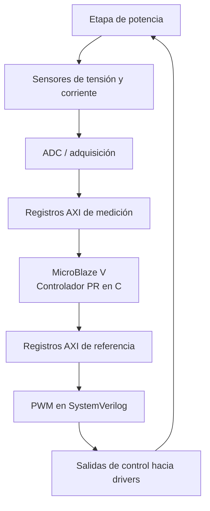
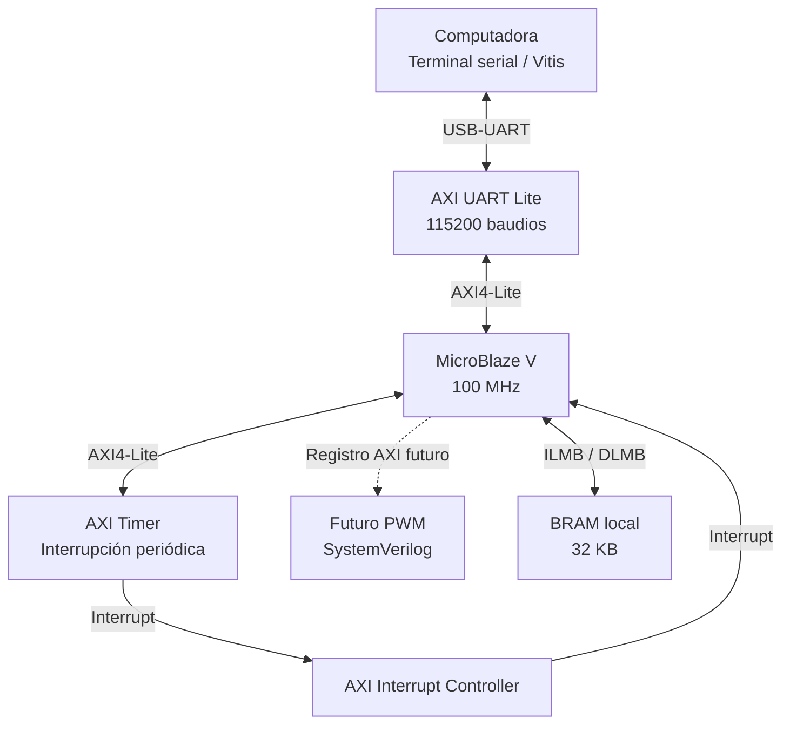
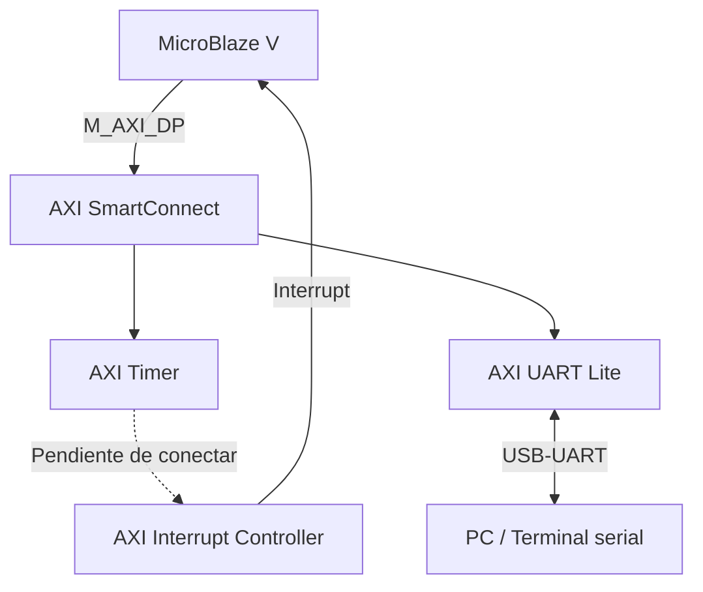

# EL3313-Proyecto 4: Reloj Digital Embebido con MicroBlaze V Sistema de Alarma y Cron´ometro

## Fases y Módulos de la Etapa Digital
### RISC-V Microblaze 
La arquitectura planteada sigue la siguiente lógica

#### AXI Timer
