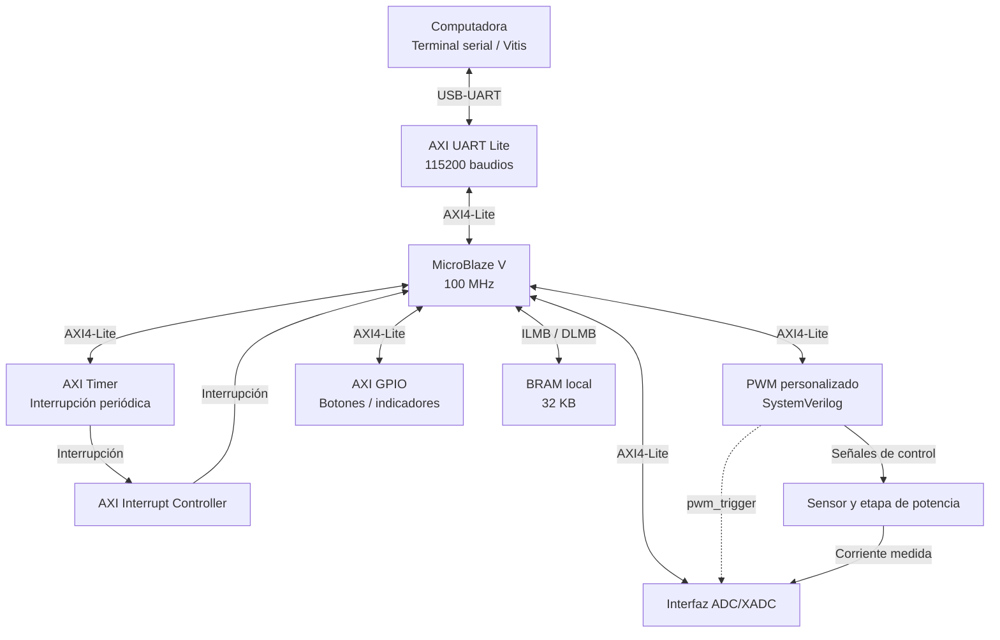
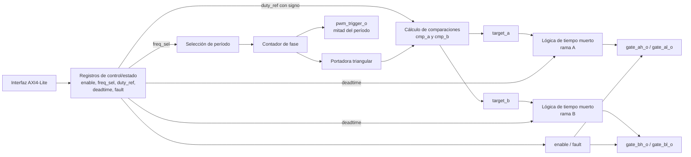
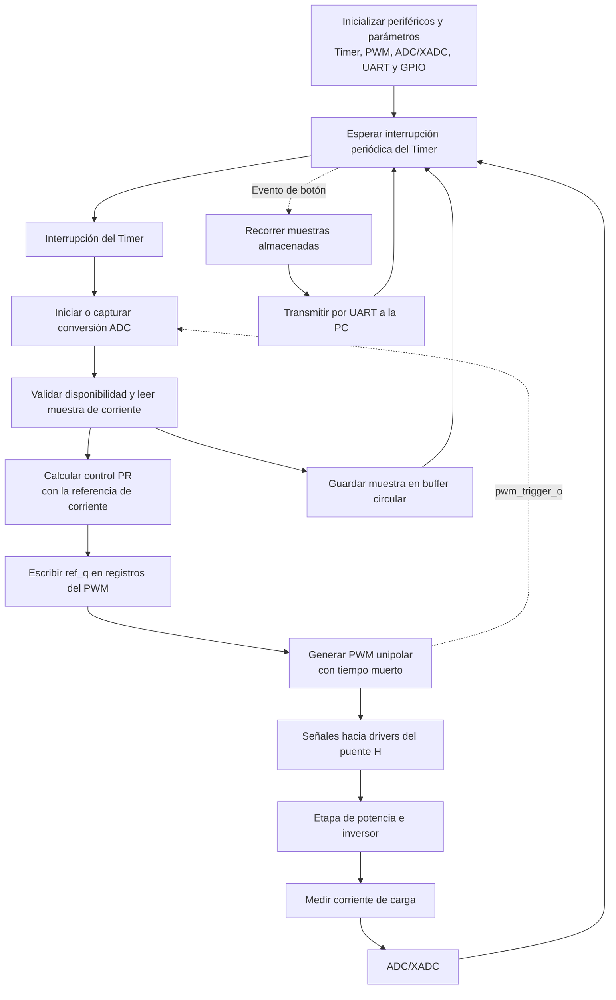

# Control de corriente en un inversor monofásico mediante un regulador PR discreto sobre MicroBlaze V

## 1. Introducción y objetivos

### 1.1. Introducción

El presente proyecto consiste en el diseño de un sistema digital embebido basado en el procesador MicroBlaze V, implementado sobre una FPGA Artix-7. El sistema tiene como propósito proporcionar una plataforma de procesamiento, adquisición de datos y generación de señales de control para un inversor monofásico en puente H, encargado de regular la corriente de una carga RL mediante un controlador proporcional-resonante (PR) discreto.

Desde la perspectiva de Taller de Diseño Digital, el proyecto contempla la integración del procesador MicroBlaze V con diferentes periféricos mediante interfaces AXI4-Lite. Entre estos se encuentran un generador PWM personalizado desarrollado en SystemVerilog, una interfaz de adquisición ADC/XADC, un temporizador para la ejecución periódica del control y módulos de comunicación UART y GPIO.

La arquitectura propuesta distribuye las funciones entre hardware y software. Los periféricos digitales se encargan de las operaciones de adquisición, generación de señales y comunicación, mientras que el procesador ejecuta el programa de control desarrollado en C. Esta distribución permite implementar un sistema modular, cuyos componentes pueden diseñarse, verificarse e integrarse progresivamente.

El trabajo de Taller de Diseño Digital se concentra en la arquitectura embebida, las interfaces entre el procesador y sus periféricos, la adquisición y generación de señales y el software que ejecuta periódicamente el control. La integración con la etapa de potencia se realiza en coordinación con el diseño del inversor.

### 1.2. Objetivo general

Diseñar un sistema digital embebido basado en MicroBlaze V, integrando periféricos mediante interfaces AXI4-Lite y módulos personalizados en SystemVerilog, para implementar la adquisición de corriente, la ejecución periódica de un controlador PR discreto y la generación de señales PWM destinadas al control de un inversor monofásico.

### 1.3. Objetivos específicos

1. Definir una arquitectura modular basada en MicroBlaze V que integre memoria, periféricos de comunicación, temporización y módulos personalizados mediante interfaces AXI.

2. Diseñar un periférico PWM personalizado en SystemVerilog, con modulación unipolar, tiempo muerto configurable, selección de frecuencias de conmutación e interfaz AXI4-Lite.

3. Establecer un sistema de adquisición de datos mediante ADC/XADC que permita obtener muestras de corriente sincronizadas con la generación de señales PWM.

4. Diseñar la estructura del software embebido en C para gestionar las interrupciones periódicas, ejecutar el algoritmo de control PR, actualizar los registros del PWM y almacenar las muestras adquiridas.

5. Definir un mecanismo de comunicación UART que permita transmitir a una computadora el historial de muestras almacenadas, mediante una solicitud realizada desde la FPGA.

6. Establecer una estrategia de verificación basada en simulaciones, testbenches autoverificables y pruebas funcionales en FPGA para comprobar los módulos digitales y su integración.

## 2. Requisitos del sistema

El sistema deberá cumplir con los siguientes requisitos:

1. **Etapa de potencia:** inversor monofásico en puente H, alimentado entre 12 y 24 V DC, con una carga RL dimensionada y justificada.

2. **Referencia de corriente:** seguimiento de una señal sinusoidal de 50 Hz, con amplitudes de 0,2 A, 0,5 A y 1,0 A pico.

3. **Control PWM:** implementación de un regulador PR discreto y generación de modulación PWM unipolar con tiempo muerto configurable.

4. **Adquisición y comunicación:** medición de corriente sincronizada con el PWM y comunicación entre periféricos mediante registros AXI4-Lite.

5. **Sistema embebido:** procesador MicroBlaze V a 100 MHz, con 32 KB de memoria local, 8 KB de caché de instrucciones y ejecución periódica mediante interrupciones.

6. **Periférico personalizado:** desarrollo de un controlador PWM en SystemVerilog, con interfaz AXI4-Lite y al menos tres frecuencias de conmutación seleccionables.

Los parámetros de conmutación, muestreo y control deberán definirse y justificarse de acuerdo con las condiciones de operación del sistema.

## 3. Arquitectura y diseño de hardware

### 3.1. Arquitectura general

La arquitectura propuesta se basa en el procesador MicroBlaze V sobre una FPGA Artix-7. El procesador ejecuta el software de control en C y administra los periféricos digitales mediante interfaces AXI4-Lite [2].

La arquitectura contempla memoria BRAM para el almacenamiento de instrucciones y datos, un temporizador para generar interrupciones periódicas, una interfaz UART para transmitir información y módulos de adquisición y generación PWM.

El funcionamiento previsto consiste en adquirir una muestra de corriente mediante el ADC/XADC, procesarla utilizando el controlador PR discreto y actualizar el periférico PWM para generar las señales de actuación correspondientes.

### 3.2. Módulos del sistema

La tabla resume los bloques de la arquitectura descrita para el sistema y la función asignada a cada uno.

| Módulo | Función en el sistema |
|---|---|
| MicroBlaze V | Ejecuta el software embebido y administra los periféricos. |
| BRAM local y caché de instrucciones | Almacenan el programa y los datos del sistema; la caché mejora el acceso a instrucciones. |
| AXI SmartConnect | Interconecta el procesador y los periféricos accesibles mediante AXI. |
| AXI Timer y AXI Interrupt Controller | Generan la base temporal del lazo y entregan la interrupción al procesador. |
| AXI UART Lite | Transmite a una computadora el historial de muestras solicitado por el usuario. |
| AXI GPIO | Lee botones y controla indicadores de estado. |
| Interfaz ADC/XADC | Adquiere las mediciones de corriente para el lazo de control. |
| PWM personalizado | Genera la modulación unipolar y las señales complementarias con tiempo muerto configurable. |
| MDM | Proporciona la interfaz de depuración del sistema embebido. |

La arquitectura permite desarrollar y verificar los módulos individualmente y luego integrarlos mediante las interfaces definidas.

### 3.3. Diagramas del sistema

#### 3.3.1. Diagramas generales del sistema

##### 3.3.1.1. Nivel 1

##### 3.3.1.2. Nivel 2

##### 3.3.1.3. Nivel 3

#### 3.3.2. Arquitectura general del sistema digital

El diagrama resume la arquitectura digital propuesta en Vivado [3] y las relaciones de comunicación entre sus bloques: MicroBlaze V accede a BRAM y a los periféricos por AXI; el Timer entrega una interrupción periódica; el PWM sincroniza la adquisición y genera las señales de actuación; la UART enlaza el sistema con la computadora.

#### 3.3.3. Interconexión y temporización del AXI Timer

El diagrama detalla la conexión del MicroBlaze V con el Timer y la UART a través de AXI SmartConnect, y el trayecto de la interrupción periódica desde el Timer hasta el procesador.

#### 3.3.4. Diagrama interno del PWM personalizado

El diagrama resume la implementación RTL: los registros AXI configuran la frecuencia, la referencia y el tiempo muerto; la portadora triangular y las comparaciones producen las órdenes de conmutación de las dos ramas, que pasan por la lógica de tiempo muerto. La señal `pwm_trigger_o` se genera en la mitad del período, y la habilitación y la falla controlan las salidas.

A continuacion se desarrolla el diagrama de 4 nivel para este modulo:
a) Nombre del modulo: PWM unipolar con AXI4-Lite

b) Diagrama modular.

Diagrama tercer nivel

c) Objetivo del modulo.
Es el actuador digital del lazo de control. Convierte el resultado del controlador PR, que el MicroBlaze V calcula en software, en las señales de compuerta que accionan el puente H del inversor. Así la corriente de la carga RL sigue la referencia sinusoidal de 50 Hz.
Recibe duty_ref por AXI4-Lite. El software lo escribe una vez por período de control. Representa la tensión que el PR pide aplicar, normalizada entre −1 y 1.
Genera la modulación PWM unipolar. La tensión promedio sobre la carga resulta Vdc · duty_ref, con rizado al doble de la frecuencia de conmutación.
Inserta el tiempo muerto. Así los dos transistores de una misma rama nunca conducen a la vez, lo que evitaría un cortocircuito de la fuente.
Sincroniza la medición. Emite pwm_trigger_o una vez por período, en el centro, para que el XADC muestree la corriente en un instante limpio.
Protege el puente. Apaga las cuatro compuertas de inmediato ante fault_i o al deshabilitarse, y expone running para monitoreo.

d) Entradas.
| Señal | Descripción |
|---|---|
| aclk | Reloj del sistema, 100 MHz. |
| aresetn | Reset síncrono, activo en bajo. |
| s_axi_awaddr | 	Dirección de escritura (offset en bytes). |
| s_axi_awprot | 	Atributos AXI. Se ignoran. |
| s_axi_awvalid | Dirección de escritura válida. |
| s_axi_wdata | Dato de escritura |
| s_axi_wstrb | Habilitación por byte del dato de escritura. |
| s_axi_wvalid | Dato de escritura válido. |
| s_axi_bready |. |
| s_axi_araddr | . |
| s_axi_arprot | l. |
| s_axi_arvalid | |
| s_axi_rready| . |
| fault_i | . |

e) Salidas.
e) Salidas.
e) Salidas.
f) Explicaci´on de la relaci´on con otros m´odulos.
g) Explicaci´on de funcionamiento.
h) Dise˜no. ¿C´omo se dise˜na? Justificaci´on, tablas de verdad, implificaciones, uso de m´odulos integrados, etc.

## 4. Interfaces y comunicación

### 4.1. Comunicación mediante AXI4-Lite

MicroBlaze V actúa como maestro AXI y accede a los periféricos por medio de AXI SmartConnect. AXI4-Lite organiza las transacciones en cinco canales [4]:

| Canal | Función |
|---|---|
| AW | Dirección de escritura |
| W | Datos de escritura |
| B | Respuesta de escritura |
| AR | Dirección de lectura |
| R | Datos y respuesta de lectura |

Cada periférico se localiza mediante una dirección base asignada en el Address Editor de Vivado; sus registros se identifican mediante offsets relativos a esa dirección.

### 4.2. Mapa de memoria

El Block Design asigna las siguientes direcciones a la memoria local y a los periféricos:

| Módulo | Dirección base | Rango | Función |
|---|---:|---:|---|
| BRAM local | `0x00000000` | 32 KB | Memoria de instrucciones y datos, accesible mediante ILMB y DLMB. |
| AXI UART Lite | `0x40600000` | 64 KB | Comunicación serial. |
| AXI Interrupt Controller | `0x41200000` | 64 KB | Gestión de interrupciones. |
| AXI Timer | `0x41C00000` | 64 KB | Temporización periódica. |

Los offsets de los registros del PWM se describen en la sección siguiente; su dirección base depende de la asignación del Address Editor.

### 4.3. Registros del periférico PWM

El RTL de `pwm_axi_lite.sv` define los registros siguientes. Los offsets son relativos a la dirección base del periférico. La guía de Vivado para empaquetar IP personalizado se cita en [5].

| Offset | Campo | Acceso | Bits | Función |
|---|---|---|---|---|
| `0x00` | `enable` | R/W | `[0]` | Habilita la generación PWM. |
| `0x00` | `freq_sel` | R/W | `[2:1]` | Selecciona 10, 12.5 o 20 kHz; el selector `2'b11` no es válido. |
| `0x00` | `running` | RO | `[3]` | Indica que el generador está activo y no está inhibido por una falla. |
| `0x04` | `ref_q` | R/W | `[15:0]` | Referencia de modulación con signo en formato Q1.15; se limita al intervalo de −32767 a 32767. |
| `0x08` | `deadtime_q` | R/W | `[7:0]` | Tiempo muerto en ciclos de reloj, limitado a 1–100; valor inicial 20. |
| `0x0C` | `fault_latched` | RO | `[0]` | Indica una falla enclavada; se borra al deshabilitar el PWM. |
| `0x0C` | `fault_i` | RO | `[1]` | Refleja la entrada de falla actual. |

Los demás bits de estos registros están reservados. El RTL responde con `SLVERR` ante direcciones de registro no implementadas y ante el selector de frecuencia reservado.

### 4.4. Señales de entrada y salida

Las señales del periférico PWM corresponden a su interfaz RTL. Las señales de ADC/XADC, Timer, UART y GPIO resumen las funciones requeridas para la arquitectura del sistema; la adquisición XADC se describe en la guía del dispositivo [6].

| Módulo | Entradas | Salidas | Función |
|---|---|---|---|
| PWM personalizado | `aclk`, `aresetn`, canales AXI4-Lite, `fault_i` | Canales de respuesta AXI, `gate_ah_o`, `gate_al_o`, `gate_bh_o`, `gate_bl_o`, `pwm_trigger_o` | Configura la modulación, acciona las ramas del puente y sincroniza la adquisición. |
| ADC/XADC | Inicio de conversión o `pwm_trigger_o` | Indicador de dato disponible y muestra digital | Adquiere la corriente de carga. |
| AXI Timer | Acceso AXI y reloj/reset | `interrupt` | Genera la interrupción periódica del control. |
| AXI UART Lite | Datos y control por AXI; recepción serial | Transmisión serial | Envía las muestras almacenadas a la computadora. |
| AXI GPIO | Lectura de botones | Control de indicadores | Permite la solicitud de exportación e indica estados del sistema. |

### 4.5. Interconexión y sincronización

AXI4-Lite sirve para configurar y consultar los periféricos. La temporización del lazo se obtiene de la interrupción del AXI Timer [7], que llega a MicroBlaze V por el AXI Interrupt Controller. Por separado, `pwm_trigger_o` permite alinear la adquisición ADC/XADC con el período PWM. El procesador lee la muestra y escribe la referencia calculada en el registro del PWM. La UART permite transmitir el historial hacia la computadora [8].

## 5. Funcionamiento e integración

### 5.1. Funcionamiento del software

El flujo descrito para la aplicación embebida en C comprende estas etapas:

1. **Inicialización:** MicroBlaze V configura el Timer, PWM, ADC/XADC, UART y GPIO, y establece los parámetros iniciales de operación.
2. **Ejecución periódica:** la interrupción del Timer inicia o captura la conversión ADC/XADC; la rutina valida la disponibilidad del dato, lee la muestra, calcula la ley PR y actualiza `ref_q` en el PWM.
3. **Almacenamiento:** cada muestra se guarda en un buffer circular para mantener el historial.
4. **Exportación:** ante un evento del botón, el sistema recorre el historial y transmite las muestras por UART a la computadora.

### 5.2. Integración del sistema

El siguiente diagrama organiza el ciclo de control completo descrito en la especificación: la medición se realimenta desde la etapa de potencia; el Timer inicia cada iteración; la referencia calculada actualiza el PWM; y la solicitud del botón permite exportar el historial sin formar parte de la secuencia periódica.

## 6. Estrategia de implementación y validación

### 6.1. Metodología de implementación

El desarrollo del sistema se realizará mediante una metodología incremental, permitiendo verificar el funcionamiento de cada módulo antes de integrarlo con los demás componentes.

Se establecen las siguientes fases:

1. **Configuración del sistema base:** implementación del procesador MicroBlaze V, memoria, reloj e interfaces de comunicación en Vivado, verificando su funcionamiento mediante un programa de prueba en Vitis.

2. **Desarrollo de periféricos:** configuración de los módulos AXI Timer, UART y GPIO, además del diseño del controlador PWM personalizado en SystemVerilog y la interfaz ADC/XADC.

3. **Integración de hardware:** conexión de los periféricos mediante AXI4-Lite, asignación de direcciones y verificación de las operaciones de lectura y escritura.

4. **Desarrollo del software:** implementación en C de las interrupciones periódicas, adquisición de corriente, ejecución del controlador PR, actualización del PWM y almacenamiento y transmisión de muestras.

5. **Validación del sistema:** ejecución de simulaciones y pruebas funcionales para verificar la comunicación entre módulos, la temporización y el funcionamiento integrado.

### 6.2. Estrategia de verificación

La verificación del sistema se realizará mediante simulaciones en Vivado, testbenches autoverificables y pruebas funcionales sobre la FPGA.

Se contemplan las siguientes pruebas:

| Módulo | Prueba de verificación |
|---|---|
| MicroBlaze V | Comprobar la ejecución de software y la comunicación con los periféricos. |
| PWM personalizado | Verificar las tres frecuencias de conmutación, modulación unipolar, tiempo muerto y habilitación. |
| Interfaz AXI4-Lite | Comprobar la lectura y escritura de registros, estados y saturación de referencias. |
| ADC/XADC | Verificar la adquisición de muestras y su sincronización con el PWM. |
| AXI Timer | Comprobar la generación periódica de interrupciones y medir el período efectivo y su jitter. |
| UART y GPIO | Verificar la transmisión de muestras almacenadas al presionar un botón. |
| Sistema integrado | Comprobar la ejecución coordinada de adquisición, procesamiento y actualización del PWM. |

### 6.3. Criterios de validación

El periférico PWM contará con un testbench autoverificable que permita comprobar automáticamente las condiciones de funcionamiento y reportar los resultados de cada prueba.

Se verificará especialmente que las señales complementarias respeten el tiempo muerto establecido, que las referencias fuera de rango sean saturadas correctamente y que la señal `pwm_trigger_o` permita sincronizar la adquisición.

Adicionalmente, se realizará una simulación temporizada posterior a la implementación del periférico personalizado.

La validación final comprobará que los periféricos se comuniquen correctamente con MicroBlaze V, que las interrupciones mantengan la periodicidad requerida y que la transmisión UART no interfiera con la ejecución del lazo de control.

## 7. Bibliografía

[1] EL3313 Taller de Diseño Digital y EL4201 Procesamiento Electrónico de Potencia, “Proyecto 4: Control de corriente en un inversor monofásico mediante un regulador PR discreto sobre MicroBlaze V,” II semestre de 2026. Documento de especificaciones del proyecto.

[2] AMD, *MicroBlaze V Processor Reference Guide*, UG1629. [En línea]. Disponible en: https://docs.amd.com/r/en-US/ug1629-microblaze-v-user-guide/.

[3] AMD, *Vivado Design Suite User Guide: Designing IP Subsystems*, UG994. [En línea]. Disponible en: https://docs.amd.com/r/en-US/ug994-vivado-ip-subsystems.

[4] AMD, *AXI Reference Guide*, UG1037. [En línea]. Disponible en: https://docs.amd.com/v/u/en-US/ug1037-vivado-axi-reference-guide.

[5] AMD, *Vivado Design Suite User Guide: Creating and Packaging Custom IP*, UG1118. [En línea]. Disponible en: https://docs.amd.com/r/en-US/ug1118-vivado-creating-packaging-custom-ip.

[6] AMD, *7 Series FPGAs and Zynq-7000 SoC XADC Dual 12-Bit 1 MSPS Analog-to-Digital Converter User Guide*, UG480. [En línea]. Disponible en: https://docs.amd.com/r/en-US/ug480_7Series_XADC.

[7] AMD, *AXI Timer Product Guide*, PG079. [En línea]. Disponible en: https://docs.amd.com/r/en-US/pg079-axi-timer.

[8] AMD, *AXI UART Lite Product Guide*, PG142. [En línea]. Disponible en: https://docs.amd.com/r/en-US/pg142-axi-uartlite.
