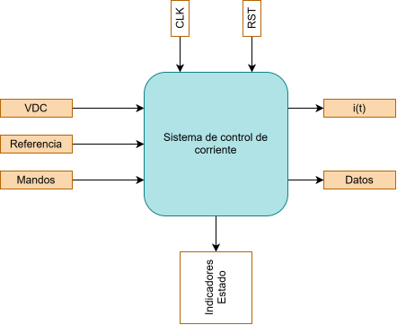
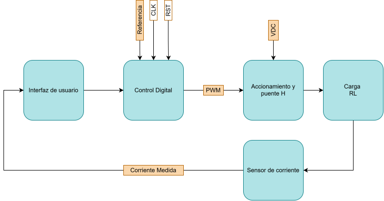
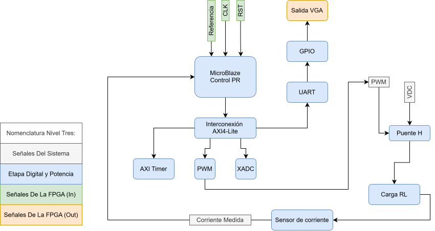
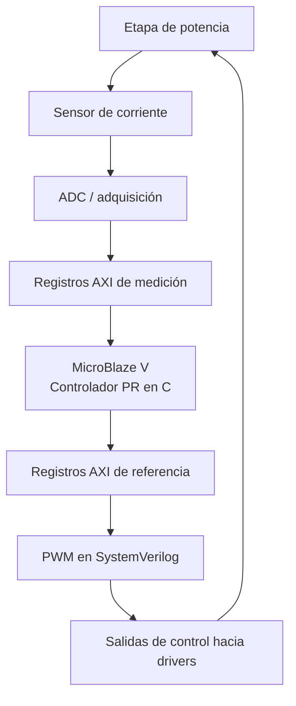
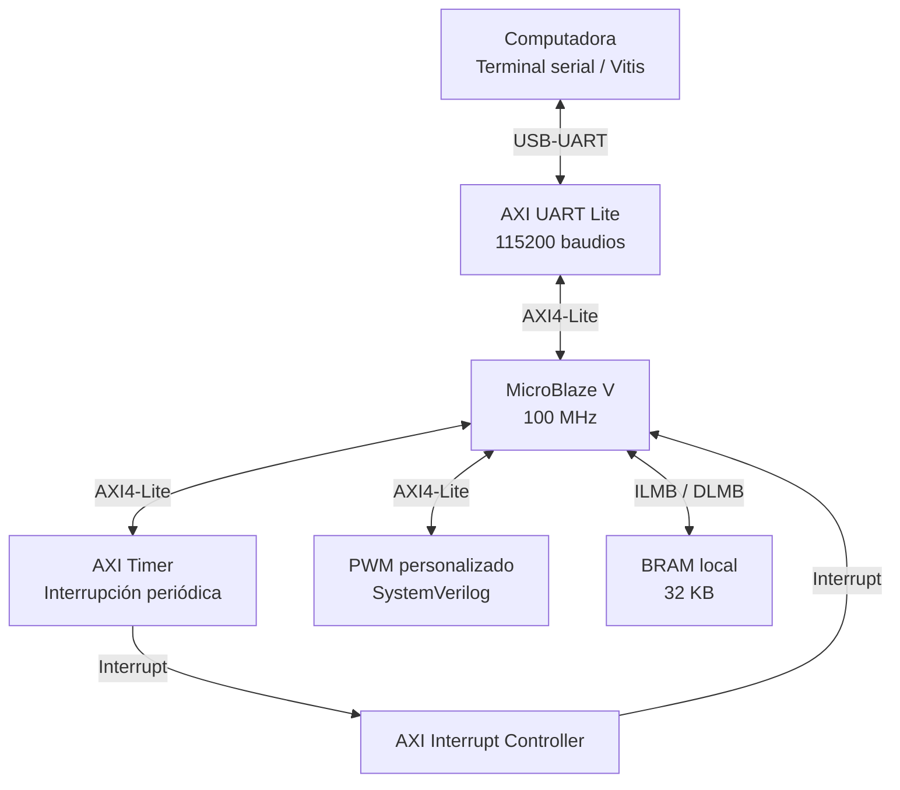
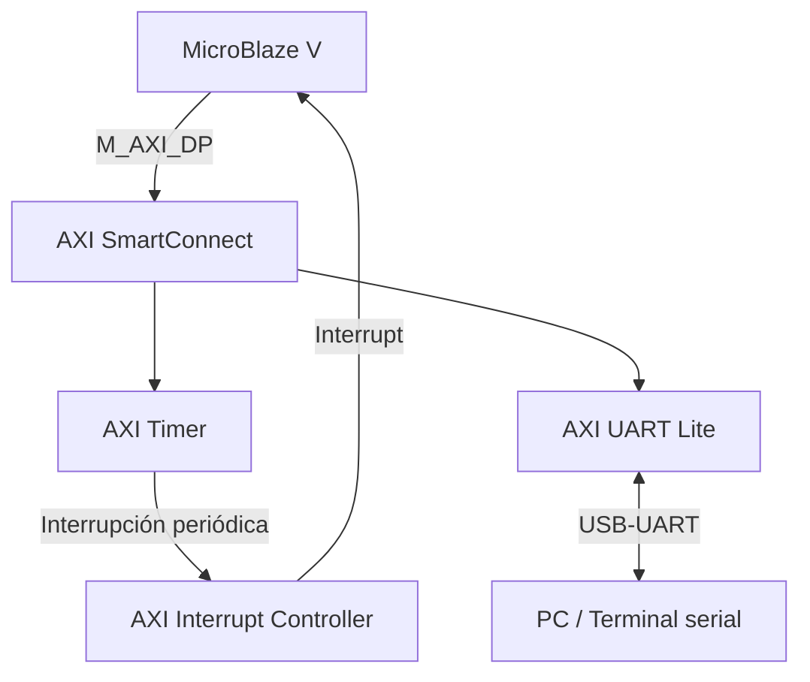

# Control de corriente en un inversor monofásico mediante un regulador PR discreto sobre MicroBlaze V

# 1. Introducción y objetivos

## 1.1. Introducción

El presente proyecto consiste en el diseño de un sistema digital embebido basado en el procesador MicroBlaze V, implementado sobre una FPGA Artix-7. El sistema tiene como propósito proporcionar una plataforma de procesamiento, adquisición de datos y generación de señales de control para un inversor monofásico en puente H, encargado de regular la corriente de una carga RL mediante un controlador proporcional-resonante (PR) discreto.

Desde la perspectiva de Taller de Diseño Digital, el proyecto contempla la integración del procesador MicroBlaze V con diferentes periféricos mediante interfaces AXI4-Lite. Entre estos se encuentran un generador PWM personalizado desarrollado en SystemVerilog, una interfaz de adquisición ADC/XADC, un temporizador para la ejecución periódica del control y módulos de comunicación UART y GPIO.

La arquitectura propuesta distribuye las funciones entre hardware y software. Los periféricos digitales se encargan de las operaciones de adquisición, generación de señales y comunicación, mientras que el procesador ejecuta el programa de control desarrollado en C. Esta distribución permite implementar un sistema modular, cuyos componentes pueden diseñarse, verificarse e integrarse progresivamente.

El desarrollo de la plataforma digital se realiza en coordinación con el sistema de potencia, responsable de proporcionar las condiciones de operación del inversor y los parámetros del controlador PR. De esta manera, el diseño digital se concentra en la implementación de la lógica de control y las interfaces necesarias para su integración con la etapa de potencia.

## 1.2. Objetivo general

Diseñar un sistema digital embebido basado en MicroBlaze V, integrando periféricos mediante interfaces AXI4-Lite y módulos personalizados en SystemVerilog, para implementar la adquisición de corriente, la ejecución periódica de un controlador PR discreto y la generación de señales PWM destinadas al control de un inversor monofásico.

## 1.3. Objetivos específicos

1. Definir una arquitectura modular basada en MicroBlaze V que integre memoria, periféricos de comunicación, temporización y módulos personalizados mediante interfaces AXI.

2. Diseñar un periférico PWM personalizado en SystemVerilog, con modulación unipolar, tiempo muerto configurable, selección de frecuencias de conmutación e interfaz AXI4-Lite.

3. Establecer un sistema de adquisición de datos mediante ADC/XADC que permita obtener muestras de corriente sincronizadas con la generación de señales PWM.

4. Diseñar la estructura del software embebido en C para gestionar las interrupciones periódicas, ejecutar el algoritmo de control PR, actualizar los registros del PWM y almacenar las muestras adquiridas.

5. Definir un mecanismo de comunicación UART que permita transmitir a una computadora el historial de muestras almacenadas, mediante una solicitud realizada desde la FPGA.

6. Establecer una estrategia de verificación basada en simulaciones, testbenches autoverificables y pruebas funcionales en FPGA para comprobar los módulos digitales y su integración.

## Diagramas generales del sistema
### Nivel 1

### Nivel 2

### Nivel 3

## 2. Requisitos del sistema

El sistema deberá cumplir con los siguientes requisitos:

1. **Etapa de potencia:** inversor monofásico en puente H, alimentado entre 12 y 24 V DC, con una carga RL dimensionada y justificada.

2. **Referencia de corriente:** seguimiento de una señal sinusoidal de 50 Hz, con amplitudes de 0,2 A, 0,5 A y 1,0 A pico.

3. **Control PWM:** implementación de un regulador PR discreto y generación de modulación PWM unipolar con tiempo muerto configurable.

4. **Adquisición y comunicación:** medición de corriente sincronizada con el PWM y comunicación entre periféricos mediante registros AXI4-Lite.

5. **Sistema embebido:** procesador MicroBlaze V a 100 MHz, con 32 KB de memoria local, 8 KB de caché de instrucciones y ejecución periódica mediante interrupciones.

6. **Periférico personalizado:** desarrollo de un controlador PWM en SystemVerilog, con interfaz AXI4-Lite y al menos tres frecuencias de conmutación seleccionables.

Los parámetros de conmutación, muestreo y control deberán definirse y justificarse de acuerdo con las condiciones de operación del sistema.

## Diseño general del sistema
El sistema se organiza en módulos de adquisición, procesamiento, actuación y potencia. La corriente medida se entrega al MicroBlaze V para ejecutar el control periódico; su salida actualiza el periférico PWM, que acciona el puente H y la carga RL. La plataforma contempla además la exportación de muestras a una computadora por UART.

## Diseño de hardware
La plataforma digital se implementa en FPGA con MicroBlaze V, memoria local, temporizador, UART y los periféricos de entrada y salida requeridos. El XADC adquiere la corriente y el periférico PWM personalizado genera las señales unipolares complementarias con tiempo muerto. La etapa de potencia comprende el puente H, sus circuitos de accionamiento y la carga RL.

## Fases y Módulos de la Etapa Digital
El desarrollo se plantea de forma incremental:
1. **Sistema base:** configurar el proyecto Vivado y MicroBlaze V, y comprobar la ejecución de un programa de prueba desde Vitis.
2. **Periféricos:** configurar las IP disponibles e implementar y probar el periférico PWM personalizado.
3. **Integración con MicroBlaze V:** incorporar los periféricos al Block Design, definir el mapa de memoria y comprobar su comunicación desde C.
4. **Software de control:** coordinar la adquisición, la ejecución periódica del control PR, la actualización del PWM y el envío de muestras por UART.
5. **Validación y optimización:** probar los módulos y el sistema integrado con la etapa de potencia, verificando el comportamiento temporal y funcional.

### Flujo de control de corriente
Este diagrama representa el recorrido de la señal en el lazo de control: se mide la corriente de la etapa de potencia, se convierte y se entrega al MicroBlaze V mediante registros AXI. El procesador calcula la acción de control PR, actualiza la referencia del PWM y este genera las señales para los drivers del puente H.

### Arquitectura general del sistema digital
Este diagrama muestra los bloques principales del sistema y su comunicación: el MicroBlaze V usa la BRAM para programa y datos, accede al temporizador y al PWM por AXI4-Lite, y se comunica con la computadora mediante UART. El temporizador genera la interrupción que permite ejecutar periódicamente el control.

#### Interconexión y temporización del AXI Timer
Este diagrama detalla cómo el MicroBlaze V se comunica con el temporizador y la UART a través de AXI SmartConnect. La interrupción del temporizador se dirige al controlador de interrupciones y luego al procesador para marcar la ejecución periódica.

## Diseño de software
La aplicación embebida en C ejecuta el lazo de control mediante interrupciones periódicas: adquiere la corriente, calcula la acción del PR y actualiza la referencia del PWM. También gestiona la solicitud de exportación del historial de muestras por UART.

## Integración del sistema
La integración conecta el procesador con los periféricos mediante AXI4(-Lite), sincroniza la adquisición de corriente con el PWM y enlaza las señales de actuación con la etapa de potencia. La arquitectura modular permite verificar cada periférico antes de integrar el lazo completo.

## Verificación y validación
La validación contempla pruebas funcionales del PWM y sus registros, comprobación de la adquisición y exportación de muestras, medición del período y jitter del lazo, y ensayos integrados de seguimiento de corriente con la carga RL.
