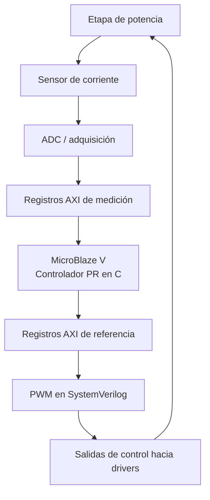
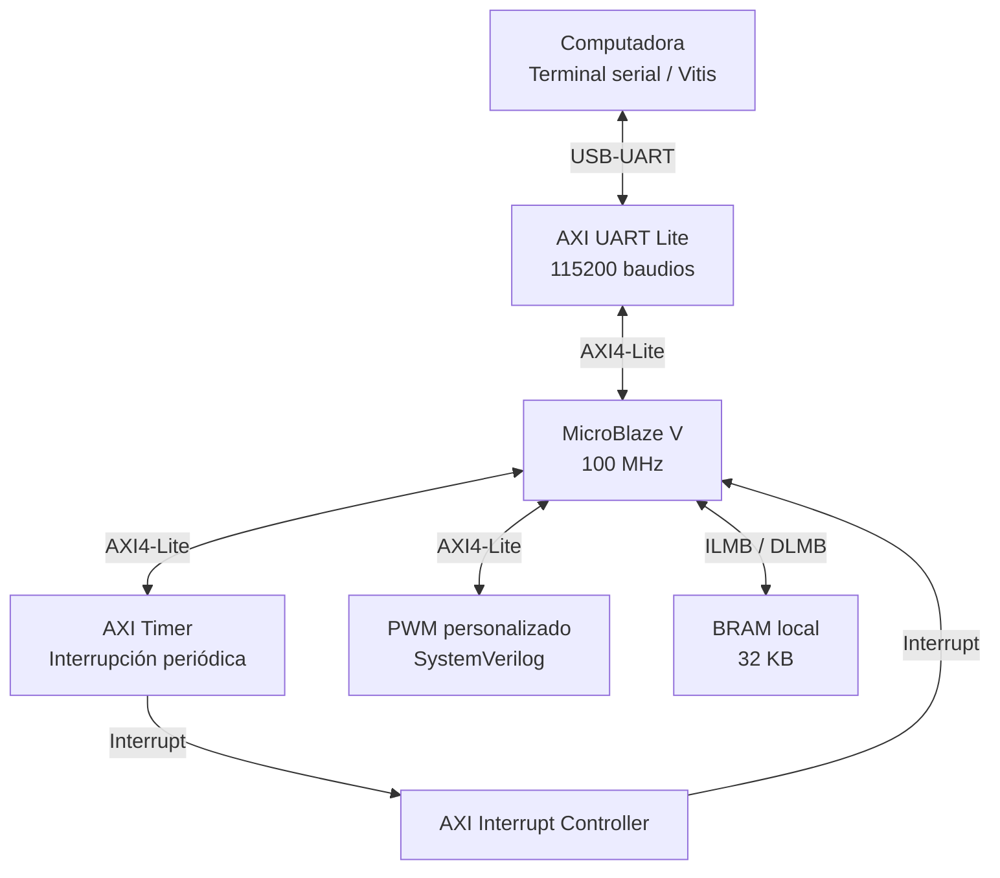
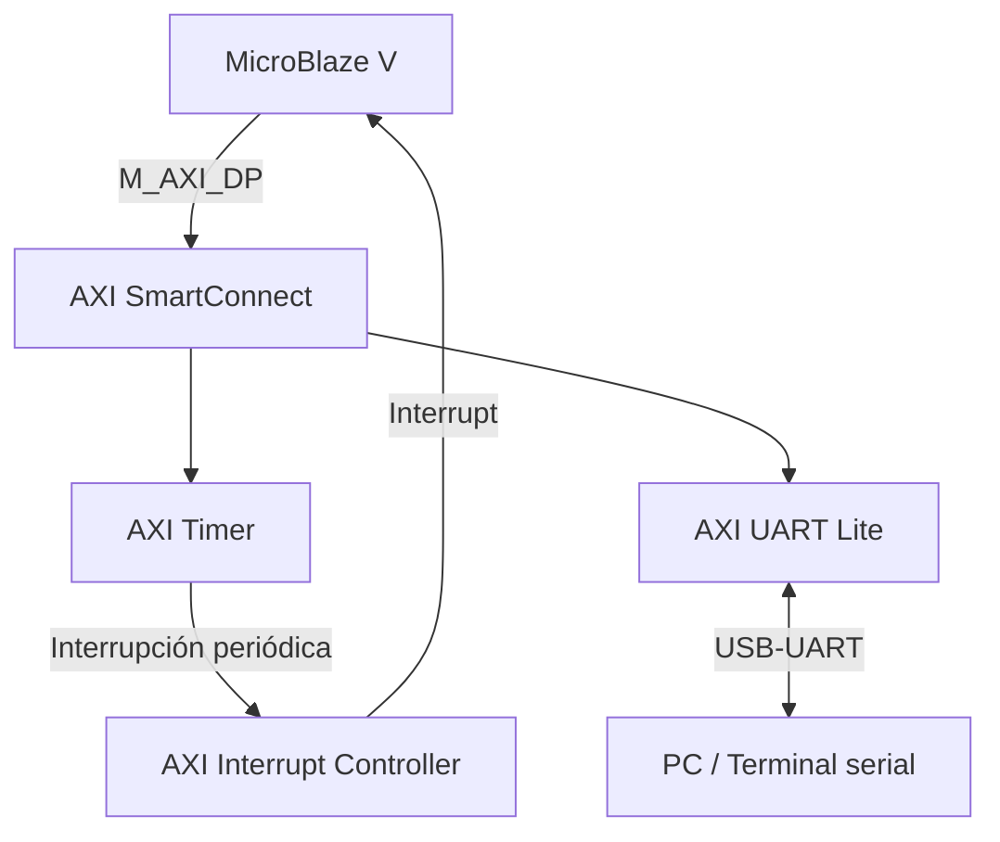

# Control de corriente en un inversor monofásico mediante un regulador PR discreto sobre MicroBlaze V

El diseño integra un sistema digital embebido basado en MicroBlaze V con un inversor monofásico en puente H. El objetivo es regular la corriente de una carga RL mediante un controlador proporcional-resonante (PR) discreto, con adquisición y actuación coordinadas desde la FPGA.

## Diagramas generales del sistema
### Nivel 1

### Nivel 2

## Requisitos del sistema
- Inversor monofásico en puente H alimentado entre 12 y 24 V DC, con carga RL dimensionada y justificada.
- Seguimiento de una referencia sinusoidal de 50 Hz con amplitudes de 0,2 A, 0,5 A y 1,0 A pico.
- Control de corriente con un regulador PR discreto y modulación PWM unipolar con tiempo muerto.
- Adquisición de corriente sincronizada con el PWM y comunicación de periféricos mediante registros AXI4(-Lite).
- MicroBlaze V a 100 MHz, memoria local de 32 KB, caché de instrucciones de 8 KB y temporización periódica del lazo.
- Periférico PWM personalizado con interfaz AXI4-Lite y al menos tres frecuencias de conmutación configurables.

## Diseño general del sistema
El sistema se organiza en módulos de adquisición, procesamiento, actuación y potencia. La corriente medida se entrega al MicroBlaze V para ejecutar el control periódico; su salida actualiza el periférico PWM, que acciona el puente H y la carga RL. La plataforma contempla además la exportación de muestras a una computadora por UART.

## Diseño de hardware
La plataforma digital se implementa en FPGA con MicroBlaze V, memoria local, temporizador, UART y los periféricos de entrada y salida requeridos. El XADC adquiere la corriente y el periférico PWM personalizado genera las señales unipolares complementarias con tiempo muerto. La etapa de potencia comprende el puente H, sus circuitos de accionamiento y la carga RL.

## Fases y Módulos de la Etapa Digital
El desarrollo se plantea de forma incremental:
1. **Sistema base:** configurar el proyecto Vivado y MicroBlaze V, y comprobar la ejecución de un programa de prueba desde Vitis.
2. **Periféricos:** configurar las IP disponibles e implementar y probar el periférico PWM personalizado.
3. **Integración con MicroBlaze V:** incorporar los periféricos al Block Design, definir el mapa de memoria y comprobar su comunicación desde C.
4. **Software de control:** coordinar la adquisición, la ejecución periódica del control PR, la actualización del PWM y el envío de muestras por UART.
5. **Validación y optimización:** probar los módulos y el sistema integrado con la etapa de potencia, verificando el comportamiento temporal y funcional.

### Flujo de control de corriente
Este diagrama representa el recorrido de la señal en el lazo de control: se mide la corriente de la etapa de potencia, se convierte y se entrega al MicroBlaze V mediante registros AXI. El procesador calcula la acción de control PR, actualiza la referencia del PWM y este genera las señales para los drivers del puente H.

### Arquitectura general del sistema digital
Este diagrama muestra los bloques principales del sistema y su comunicación: el MicroBlaze V usa la BRAM para programa y datos, accede al temporizador y al PWM por AXI4-Lite, y se comunica con la computadora mediante UART. El temporizador genera la interrupción que permite ejecutar periódicamente el control.

#### Interconexión y temporización del AXI Timer
Este diagrama detalla cómo el MicroBlaze V se comunica con el temporizador y la UART a través de AXI SmartConnect. La interrupción del temporizador se dirige al controlador de interrupciones y luego al procesador para marcar la ejecución periódica.

## Diseño de software
La aplicación embebida en C ejecuta el lazo de control mediante interrupciones periódicas: adquiere la corriente, calcula la acción del PR y actualiza la referencia del PWM. También gestiona la solicitud de exportación del historial de muestras por UART.

## Integración del sistema
La integración conecta el procesador con los periféricos mediante AXI4(-Lite), sincroniza la adquisición de corriente con el PWM y enlaza las señales de actuación con la etapa de potencia. La arquitectura modular permite verificar cada periférico antes de integrar el lazo completo.

## Verificación y validación
La validación contempla pruebas funcionales del PWM y sus registros, comprobación de la adquisición y exportación de muestras, medición del período y jitter del lazo, y ensayos integrados de seguimiento de corriente con la carga RL.