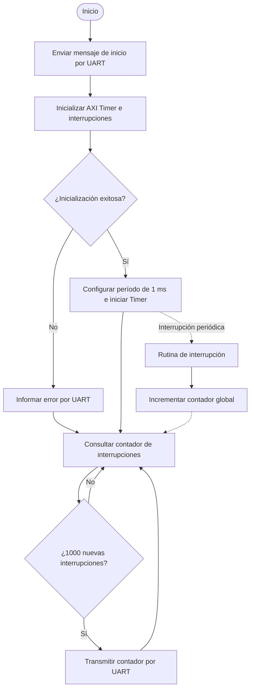
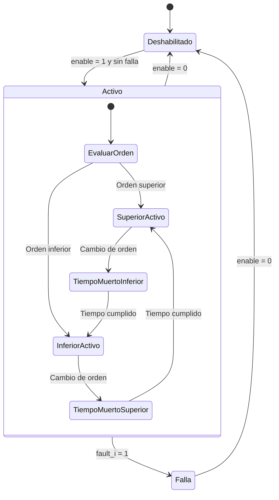
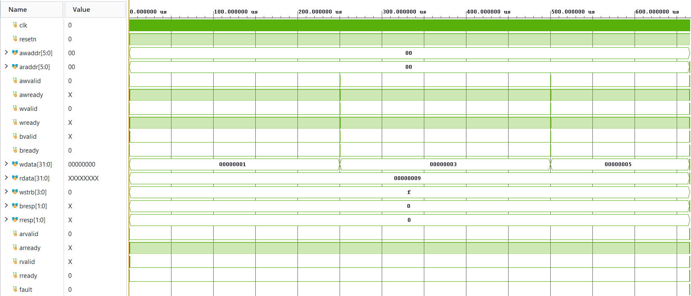
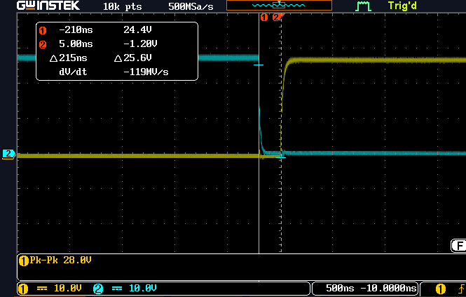
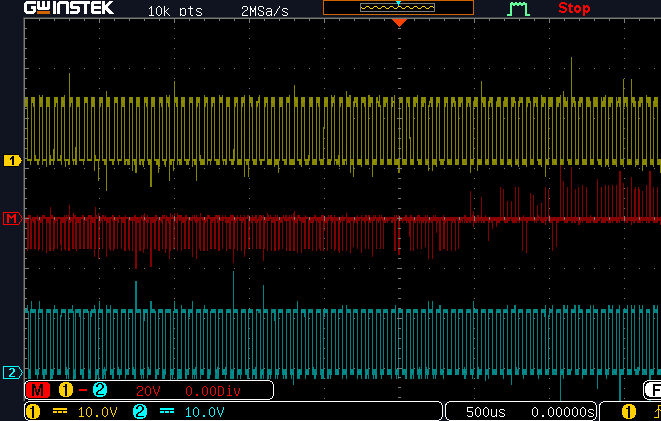
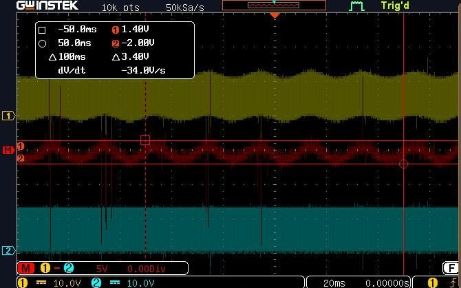
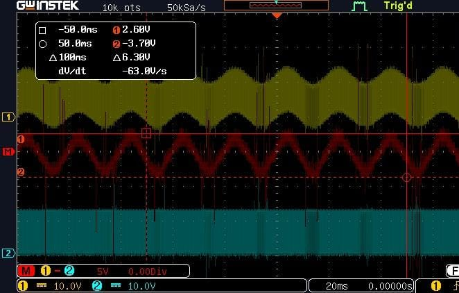

## Informe técnico — Proyecto 4: Control de corriente en un inversor monofásico mediante un regulador PR discreto sobre MicroBlaze V

Curso: EL3313 Taller de Diseño Digital

Semestre: II Semestre 2026

Proyecto: Control de corriente en un inversor monofásico y mediante un regulador PR discreto sobre MicroBlaze V

Plataforma FPGA: Digilent Basys 3


## Resumen

El proyecto consiste en el desarrollo de un sistema digital embebido basado en MicroBlaze V sobre una FPGA Basys 3, destinado al control de corriente de un inversor monofásico mediante un regulador PR discreto. La arquitectura emplea interfaces AXI4-Lite para integrar periféricos de temporización, adquisición de datos, generación PWM y comunicación UART. Se configuró y validó el sistema base en Vivado y Vitis, comprobando la ejecución de código C, la comunicación serial y el funcionamiento de las interrupciones periódicas del AXI Timer. Adicionalmente, se desarrolló un periférico PWM personalizado en SystemVerilog con su respectivo testbench y se incorporó el XADC al diseño de hardware. Estos avances establecen la base para completar la integración y verificar el funcionamiento del sistema de control.


## Introducción

El presente proyecto tiene como objetivo desarrollar un sistema digital embebido basado en el procesador MicroBlaze V, implementado sobre una FPGA Artix-7 de la tarjeta Basys 3. Este sistema está orientado al control de corriente de un inversor monofásico mediante un regulador proporcional-resonante (PR) discreto, integrando diferentes periféricos digitales para la adquisición de datos, la generación de señales de control y la comunicación con una computadora.

La arquitectura utiliza interfaces AXI4-Lite para establecer la comunicación entre el procesador y los periféricos. Entre sus componentes principales se encuentran el AXI Timer, encargado de establecer la base temporal mediante interrupciones periódicas; el ADC/XADC, destinado a la adquisición de muestras de corriente; el controlador PWM personalizado, desarrollado en SystemVerilog; y el AXI UART Lite, utilizado para transmitir información hacia una computadora. El software embebido se desarrolla en C mediante Vitis, mientras que la configuración e integración del hardware se realizan en Vivado.

Este informe presenta los fundamentos teóricos, las decisiones de diseño y la implementación de la plataforma digital. Asimismo, documenta las pruebas funcionales, los resultados de simulación y la verificación de los componentes desarrollados, con el propósito de evaluar el cumplimiento de los requisitos establecidos e identificar las principales limitaciones y oportunidades de mejora del sistema.


## Fundamentación teórica

Esta sección presenta los conceptos que sustentan el diseño digital del Proyecto 4: el procesador MicroBlaze V, el controlador PWM, la interfaz de adquisición ADC/XADC y el controlador UART. Cada apartado describe el concepto, su principio de funcionamiento y su relación con las decisiones del proyecto. Los valores marcados como *propuestos* están pendientes de validación con el componente de potencia (EL4201).

---

### 1. Procesador MicroBlaze V

#### 1.1 Concepto

MicroBlaze V es un procesador *soft-core*: no es un circuito fijo en el silicio, sino una descripción de hardware que se sintetiza en la lógica programable de la FPGA. Está basado en la arquitectura de conjunto de instrucciones (ISA) abierta RISC-V y está disponible en configuraciones de 32 y 64 bits [1], [2]. AMD lo incorporó al catálogo de Vivado desde la versión 2024.1 y es compatible a nivel de hardware con el MicroBlaze clásico [2], [3], lo que permite reutilizar la infraestructura de periféricos existente.

El uso de RISC-V permite aprovechar su ecosistema de herramientas de software, y la modularidad de la ISA permite elegir qué extensiones se implementan [1], [4]. La configuración de microcontrolador descrita por AMD es un núcleo de 32 bits con las extensiones RV32IMAFC [1]:

| Extensión | Aporte |
|---|---|
| I | Instrucciones enteras base |
| M | Multiplicación y división enteras |
| A | Operaciones atómicas |
| F | Punto flotante de precisión simple |
| C | Instrucciones comprimidas de 16 bits, que reducen el tamaño del código |


#### 1.2 Arquitectura y buses

El procesador sigue una arquitectura Harvard: tiene accesos separados para instrucciones y datos. En un sistema típico se distinguen dos tipos de interfaz:

- **Memoria local (LMB, *Local Memory Bus*):** conecta el procesador con bloques de BRAM mediante los buses ILMB (instrucciones) y DLMB (datos). Es de baja latencia y de tiempo de acceso fijo.
- **AXI4 / AXI4-Lite:** el procesador actúa como maestro y accede a los periféricos como si fueran posiciones de memoria (*memory-mapped I/O*). Cada periférico ocupa un rango de direcciones y expone sus registros en *offsets* relativos a su dirección base [5].

AXI4-Lite es un subconjunto simplificado de AXI4, con transferencias individuales y sin ráfagas. Organiza la comunicación en cinco canales independientes, cada uno con un protocolo de reconocimiento `VALID`/`READY` [5]:

| Canal | Función |
|---|---|
| AW | Dirección de escritura |
| W | Dato de escritura |
| B | Respuesta de escritura |
| AR | Dirección de lectura |
| R | Dato y respuesta de lectura |

Además, el módulo de depuración MDM (*MicroBlaze Debug Module*) permite programar, detener y depurar el procesador por JTAG desde Vitis [2].


#### 1.3 Flujo de diseño y modelo de programación

El diseño se divide en dos entornos:

1. **Vivado:** se construye el *Block Design* (procesador, memoria, interconexión y periféricos), se asignan las direcciones y se genera el *bitstream*. El resultado se exporta como un archivo de plataforma (XSA).
2. **Vitis:** se crea una plataforma a partir del XSA y se desarrolla la aplicación en C en modo *bare-metal*, es decir, sin sistema operativo. El *Board Support Package* (BSP) genera `xparameters.h` con las direcciones base y proporciona los controladores de cada IP.

Desde C, el acceso a un registro de periférico es una lectura o escritura en una dirección, por ejemplo mediante `Xil_In32` y `Xil_Out32` o los controladores de cada IP.


#### 1.4 Tiempo real y determinismo

Un lazo de control digital requiere que cada iteración ocurra a intervalos regulares y que el tiempo entre la medición y la actuación sea acotado. En un sistema *bare-metal* esto se logra con una **interrupción periódica**: un temporizador (AXI Timer) genera la interrupción, el controlador de interrupciones (AXI INTC) la entrega al procesador y la rutina de servicio (ISR) ejecuta siempre la misma secuencia de operaciones [11].

Dos factores afectan el determinismo:

- **Origen del código:** las instrucciones almacenadas en la memoria local tienen latencia fija, mientras que los accesos fuera de ella dependen de la caché y pueden variar por fallos de caché. Por eso conviene mantener el código del lazo en la BRAM local.
- **Aritmética del controlador:** con la extensión F, el cálculo en punto flotante se hace en hardware. Sin ella, se emula por software y consume muchos más ciclos. La alternativa es una implementación en punto fijo.

La ISR dispone de un presupuesto de tiempo acotado. Con un reloj de 100 MHz, un ciclo dura 10 ns. A una frecuencia de conmutación de 10 kHz, medio período equivale a 50 µs, es decir, 5 000 ciclos.


#### 1.5 Relación con el proyecto

| Parámetro | Valor requerido |
|---|---|
| Frecuencia de operación | 100 MHz |
| Caché de instrucciones | 8 KB |
| Memoria local | 32 KB de BRAM (programa, datos y búfer de muestras) |
| Interfaz de periféricos | AXI4-Lite |
| Depuración | MDM |
| Base de tiempo | AXI Timer con interrupción por AXI INTC |

MicroBlaze V ejecuta la ley de control PR y coordina los periféricos, mientras que las funciones que exigen precisión temporal (modulación, adquisición, comunicación serial) se delegan a hardware dedicado [12].

---

### 2. Controlador PWM

#### 2.1 Principio de la modulación por ancho de pulso

Un convertidor de potencia opera con interruptores que solo están en conducción o en corte. Para sintetizar una tensión de valor intermedio, se conmuta entre dos niveles con una frecuencia mucho mayor que la de la señal deseada, y se controla la fracción del período en la que la salida permanece en alto. Esta fracción es el ciclo de trabajo `D` y el valor medio de la salida es:

```
v̄ = (1/T) · ∫₀ᵀ v(t) dt = D · Vdc
```

La carga RL actúa como filtro pasa bajos para la corriente. Su función de transferencia entre tensión y corriente es:

```
G(s) = I(s) / V(s) = 1 / (L·s + R)
f_c    = R / (2π·L)
```

Si la frecuencia de conmutación es muy superior a `f_c`, la corriente sigue la tensión media y el rizado de conmutación queda atenuado [6], [7].


#### 2.2 Generación digital: portadora y comparador

En una implementación digital, la modulación se obtiene comparando una **portadora** (un contador) con una **referencia** (el valor deseado). La salida está en alto mientras la portadora es menor que la referencia.

- **Diente de sierra:** el contador sube y se reinicia. Los flancos de un lado coinciden siempre.
- **Triangular (simétrica):** el contador sube y baja. Los pulsos quedan centrados en el período, lo que reduce el contenido armónico y permite muestrear en un instante definido [7], [8].

La **resolución** depende de cuántas cuentas de reloj caben en un período, `N = f_clk / f_sw`, y su equivalente en bits es `log2(N)`. Con un reloj de 100 MHz:

| `f_sw` (propuesta) | Cuentas por período | Resolución aproximada |
|---|---:|---:|
| 10 kHz | 10 000 | 13,3 bits |
| 12,5 kHz | 8 000 | 13,0 bits |
| 20 kHz | 5 000 | 12,3 bits |

A mayor frecuencia de conmutación, menor rizado pero menor resolución y mayores pérdidas por conmutación.


#### 2.3 Puente H y modulación unipolar

El inversor en puente H tiene dos ramas (A y B), cada una con un transistor superior y uno inferior. Con la carga entre los puntos medios de las dos ramas, la tensión diferencial es `v_ab = v_A − v_B`. Hay dos esquemas de modulación [6], [7]:

| Esquema | Niveles de `v_ab` | Frecuencia aparente del rizado |
|---|---|---|
| Bipolar | `±Vdc` | `f_sw` |
| **Unipolar** | `+Vdc`, `0`, `−Vdc` | `2·f_sw` |

En la modulación unipolar las dos ramas se modulan con referencias complementarias, comparadas con la misma portadora triangular:

```
d_A  = (1 + m) / 2
d_B  = (1 − m) / 2
v̄_ab = Vdc · (d_A − d_B) = m · Vdc
```

donde `m ∈ [−1, 1]` es el índice de modulación. Como `d_A + d_B = 1`, para `m > 0` solo aparecen los niveles `+Vdc` y `0`, y para `m < 0` solo `−Vdc` y `0`.

Las cuatro combinaciones de las dos ramas son:

| Rama A | Rama B | `v_ab` |
|---|---|---|
| Superior | Superior | 0 |
| Inferior | Inferior | 0 |
| Superior | Inferior | `+Vdc` |
| Inferior | Superior | `−Vdc` |

Como cada pulso de `v_ab` ocurre al doble de la frecuencia de conmutación de cada transistor, el sistema se comporta, desde el punto de vista del rizado, como un convertidor reductor con frecuencia `2·f_sw`. Despreciando `R`, el rizado pico a pico de la corriente se estima como:

```
Δi_pp     ≈ Vdc · |m| · (1 − |m|) / (2 · f_sw · L)
Δi_pp,máx = Vdc / (8 · f_sw · L)        (con |m| = 0,5)
```

A modo de ilustración, para cumplir un rizado máximo de 0,20 A con `Vdc = 24 V` y `f_sw = 10 kHz`, esta estimación exige `L ≳ 1,5 mH`. La selección definitiva de `L` y de `f_sw` corresponde a EL4201.


#### 2.4 Tiempo muerto

Los transistores no conmutan instantáneamente. Si el inferior se enciende antes de que el superior termine de apagarse, ambos conducen a la vez y cortocircuitan la fuente (*shoot-through*). Para evitarlo se inserta un **tiempo muerto** `t_d`: al cambiar de estado, ambos transistores de la rama permanecen apagados durante ese intervalo [6], [7].

El tiempo muerto tiene un costo: introduce un error de tensión que depende del sentido de la corriente, pues durante ese intervalo la rama queda determinada por el diodo del transistor que conduce la corriente. Como orden de magnitud, el error en la tensión diferencial puede alcanzar:

```
ΔV ≈ 2 · Vdc · t_d · f_sw
```

Por ejemplo, con `Vdc = 24 V`, `t_d = 210 ns` y `f_sw = 10 kHz` resulta aproximadamente 0,10 V. Este error distorsiona la corriente, en particular cerca de sus cruces por cero, y puede compensarse en el controlador. Además, un pulso más corto que el tiempo muerto no puede generarse, lo que limita el ciclo de trabajo cerca de 0 % y 100 %.

En el diseño propuesto, el tiempo muerto es programable de 1 a 100 ciclos de reloj, con valor inicial de 20. El tiempo efectivo es de aproximadamente `(D+1)` ciclos de 10 ns.


#### 2.5 Interfaz AXI4-Lite y registros

El controlador PWM es un esclavo AXI4-Lite. El software lo configura escribiendo registros mapeados en memoria [5]:

| Offset | Registro | Contenido |
|---|---|---|
| `0x00` | CONTROL | `enable`, `freq_sel` y `running` (solo lectura) |
| `0x04` | DUTY | Referencia `m` con signo en formato Q1.15 |
| `0x08` | DEADTIME | Tiempo muerto en ciclos de reloj |
| `0x0C` | STATUS | Falla enclavada y estado de `fault_i` |

Tres principios de diseño sustentan esta interfaz:

- **Formato Q1.15:** representa `m` como un entero de 16 bits con signo; el valor real es el entero dividido entre `2^15`, con rango `[−1, 1)`. El software convierte la salida del controlador PR a este formato.
- **Saturación:** toda escritura fuera del rango admisible se limita al valor válido más cercano. Así el software no puede forzar una modulación inválida.
- **Registro sombra:** la referencia, el período y el tiempo muerto escritos por el software se copian a registros activos solo al final de cada período de la portadora. Si cambiaran en medio del período, aparecerían pulsos cortados o duplicados.


#### 2.6 Sincronización con la adquisición

En una modulación simétrica, el valor medio de la corriente en un período coincide con su valor en el centro del período, es decir, en el pico y el valle de la portadora. Muestrear en ese instante evita que el rizado de conmutación contamine la medida (*aliasing* del rizado) [8]. Por eso el controlador emite una señal `pwm_trigger_o` una vez por período, en el pico de la portadora, que dispara la conversión del ADC.

El orden temporal es: muestreo en el pico, cálculo del control en el procesador y aplicación del nuevo valor al inicio del siguiente período. Estos retardos (de cómputo y de actualización del modulador) deben incluirse en el análisis de estabilidad del lazo, lo que corresponde al componente de control de EL4201.


#### 2.7 Relación con el proyecto

| Aspecto | Valor propuesto |
|---|---|
| Frecuencias de conmutación | 10, 12,5 y 20 kHz |
| Modulación | Unipolar con portadora triangular |
| Referencia | Q1.15 con signo y saturación |
| Tiempo muerto | Programable de 1 a 100 ciclos |
| Sincronización | `pwm_trigger_o` en el pico de la portadora |
| Protección | `fault_i` apaga las cuatro compuertas de inmediato |

El enunciado exige que este módulo sea personalizado y en SystemVerilog, porque no existe una IP de AMD que implemente directamente esta modulación con tiempo muerto [12].

---

### 3. Interfaz ADC/XADC

#### 3.1 Concepto

El XADC es un convertidor analógico-digital integrado en las FPGA de la serie 7 de AMD. Contiene dos ADC de 12 bits que alcanzan 1 MSPS, además de sensores internos de temperatura y tensión [9]. Las entradas externas son diferenciales. Las 16 entradas auxiliares (`VAUXP[15:0]` y `VAUXN[15:0]`) comparten los pines físicos con las E/S digitales [9].


#### 3.2 Rango de entrada y resolución

En modo unipolar, la entrada diferencial admite de 0 V a 1,0 V, y la tensión en `VP` respecto a `VN` debe ser siempre positiva [9]. Con 12 bits, el escalón de cuantización es:

```
LSB = 1 V / 2^12 ≈ 244 µV
```

El resultado de cada conversión se almacena en un registro de 16 bits, justificado hacia el bit más significativo, de modo que el dato de 12 bits ocupa los bits `[15:4]` [9].


#### 3.3 Acondicionamiento de la corriente

Como el XADC solo acepta tensiones positivas de 0 a 1 V, y la corriente del inversor es alterna, la señal del sensor debe adaptarse con un desplazamiento y una ganancia:

```
v_adc = V_off + k · i
i     = (v_adc − V_off) / k
```

donde `V_off` coloca el cero de corriente en el centro del rango (propuesto 0,5 V) y `k` (V/A) se elige para que el pico de 1,0 A, con margen, no sature el rango. La resolución en corriente es `LSB / k`. Estos valores los define EL4201 junto con el filtro antialias del sensor.


#### 3.4 Modos de muestreo

El XADC tiene dos modos de temporización [9]:

| Modo | Disparo del muestreo |
|---|---|
| Continuo | La conversión se repite sin intervención externa. |
| **Orientado a eventos** | La entrada `CONVST` fija el instante de muestreo y de inicio de la conversión. |

El modo orientado a eventos se usa cuando se necesita control preciso del instante de muestreo [9]. En este proyecto, `CONVST` se conecta a `pwm_trigger_o`, de modo que cada conversión queda alineada con el centro del período de conmutación. Una conversión completa dura aproximadamente 26 ciclos del reloj del ADC, es decir, cerca de 1 µs a 26 MHz, un tiempo mucho menor que el período del PWM.


#### 3.5 Acceso desde el procesador

El XADC se configura y se lee por el puerto de reconfiguración dinámica (DRP), un bus de registros de 7 bits de dirección [9]. En Vivado, el asistente *XADC Wizard* genera una IP con interfaz AXI4-Lite que expone esos registros al procesador. Los resultados de los canales auxiliares ocupan las direcciones `10h` a `1Fh` del espacio DRP [9]. El software lee el dato, lo desplaza 4 bits y lo convierte a amperios con la relación de la sección 3.3.


#### 3.6 Relación con el proyecto

| Aspecto | Decisión |
|---|---|
| Modo de muestreo | Orientado a eventos, disparado por `pwm_trigger_o` |
| Interfaz | XADC Wizard con AXI4-Lite |
| Entrada | Un canal auxiliar, unipolar, de 0 a 1 V |
| Instante de muestreo | Pico de la portadora (una muestra por período) |
| Resolución | 12 bits (≈ 244 µV por escalón) |

---

### 4. Controlador UART

#### 4.1 Concepto

La UART (*Universal Asynchronous Receiver/Transmitter*) es un enlace serial asíncrono: no comparte una señal de reloj entre emisor y receptor. Ambos acuerdan de antemano la velocidad (baudios) y el formato de cada carácter [10].


#### 4.2 Formato de la trama

Cada carácter se transmite en una trama:

| Campo | Descripción |
|---|---|
| Reposo | La línea permanece en nivel alto. |
| Bit de inicio | Un bit en nivel bajo que marca el comienzo. |
| Datos | De 5 a 8 bits, comenzando por el menos significativo. |
| Paridad | Opcional (par, impar o ninguna). |
| Bit de parada | Un bit en nivel alto. |

El formato más común es 8N1: 8 bits de datos, sin paridad y 1 bit de parada, es decir, 10 bits por carácter. A una velocidad de `B` baudios, la tasa efectiva y el tiempo por carácter son:

```
tasa efectiva = B / 10  caracteres/s
t_car         = 10 / B
```

Para 115 200 baudios: 11 520 caracteres por segundo, es decir, unos 86,8 µs por carácter.


#### 4.3 El IP AXI UART Lite

El AXI UART Lite es un controlador de UART con interfaz AXI4-Lite. Sus características principales son [10]:

- Transmisión y recepción independientes (*full duplex*).
- Caracteres de 5 a 8 bits, con un bit de parada y paridad par, impar o sin paridad.
- Velocidad configurable (se fija al configurar el IP).
- FIFO de 16 caracteres para transmisión y para recepción.
- Generador de velocidad (BRG) y control de interrupciones.

El procesador accede a sus registros mapeados en memoria: la FIFO de recepción, la FIFO de transmisión, el registro de estado (que indica, por ejemplo, si la FIFO de transmisión está llena) y el registro de control, que permite habilitar interrupciones y limpiar las FIFO [10].


#### 4.4 Consideraciones de tiempo en el proyecto

La exportación de `N` muestras con `B_m` caracteres por muestra tarda:

```
t_exp = 10 · N · B_m / B
```

Por ejemplo, 1 000 muestras en texto de 6 caracteres a 115 200 baudios requieren unos 0,52 s. Dos consecuencias de diseño son relevantes:

1. **La FIFO de 16 caracteres** se vacía en unos 1,4 ms a esta velocidad, por lo que el software no puede enviar datos más rápido que el enlace.
2. **Un carácter dura 86,8 µs**, un tiempo comparable con el período de control (100 µs a 10 kHz). Por eso la exportación no debe ejecutarse dentro de la ISR del lazo, sino en el programa principal o por interrupción, de modo que la transmisión no afecte la periodicidad del control.


#### 4.5 Relación con el proyecto

| Aspecto | Decisión |
|---|---|
| IP | AXI UART Lite |
| Formato | 8N1 a 115 200 baudios (propuesto) |
| Función | Enviar a la PC el historial de muestras al pulsar un botón |
| Ubicación del envío | Programa principal, fuera de la ISR del lazo |
| Almacenamiento | Búfer circular en la BRAM local |

---

### 5. Controlador proporcional-resonante (PR) discreto

El controlador proporcional-resonante (PR) es un algoritmo de control diseñado para realizar el seguimiento de señales sinusoidales. Combina una acción proporcional, que responde al error instantáneo, con una acción resonante de ancho de banda finito, que proporciona una ganancia elevada alrededor de la frecuencia fundamental de referencia y permite reducir el error en estado estacionario para señales sinusoidales.

$$
G_{PR}(s)=K_p+\frac{2K_i\omega_c s}
{s^2+2\omega_c s+\omega_0^2}
$$

En este proyecto, el controlador se plantea para seguir una referencia sinusoidal de corriente de 50 Hz, cuya frecuencia angular corresponde a:

$$
\omega_0 = 2\pi(50) \approx 314.16\ \text{rad/s}
$$

Para implementarlo en el procesador MicroBlaze V, el controlador debe discretizarse y expresarse mediante una ecuación en diferencias. Esta ecuación permite calcular la acción de control a partir del error actual y de valores almacenados de iteraciones anteriores. Su ejecución requiere establecer un período de muestreo constante y coordinar la adquisición de datos con las actualizaciones de la señal de control.

El equipo de PEDP discretizo el controlador usando el método de Tustin con prewarping. Para el calculo de los coeficientes se definieron los siguientes parámetros, Kp=6, Kr=600 y $\omega$ = 5 rad/s. A continuación se muestra la ecuación de diferencias y sus coeficientes. 

$$
u[k]=-a_1u[k-1]-a_2u[k-2]
+b_0e[k]+b_1e[k-1]+b_2e[k-2]
$$

$$
\begin{aligned}
a_1 &\approx -1.99969 \\
a_2 &\approx 0.99975 \\
b_0 &\approx 6.07499 \\
b_1 &\approx -11.99813 \\
b_2 &\approx 5.92351
\end{aligned}
$$

En la versión actual del proyecto se ha comprobado el funcionamiento de las interrupciones periódicas del AXI Timer. La implementación y validación del algoritmo PR dentro de la aplicación C permanecen pendientes.


## Enfoque de la solución y justificación del diseño

La solución se basa en una arquitectura modular que combina un procesador MicroBlaze V con periféricos digitales conectados mediante AXI4-Lite. Esta organización permite ejecutar las tareas de procesamiento en software y delegar al hardware las operaciones que requieren temporización precisa, como la generación PWM y la adquisición de datos.

Para el desarrollo se establecieron las siguientes decisiones de diseño:

| Componente | Decisión y justificación |
|---|---|
| MicroBlaze V | Se utiliza a 100 MHz, con 32 KB de memoria local y 8 KB de caché de instrucciones, cumpliendo los requisitos de procesamiento del proyecto. |
| AXI4-Lite | Permite acceder a los periféricos mediante registros mapeados en memoria, facilitando su configuración desde C. |
| AXI Timer | Se utiliza para generar interrupciones periódicas, proporcionando una base temporal independiente del ciclo principal del programa. |
| PWM personalizado | Se desarrolla en SystemVerilog para generar modulación unipolar, seleccionar frecuencias y aplicar tiempo muerto directamente en hardware. |
| ADC/XADC | Se utiliza el XADC integrado en la FPGA, configurado para adquirir datos mediante el canal VAUX6. |
| AXI UART Lite | Se aprovecha la IP disponible en Vivado para establecer comunicación serial con una computadora. |

La implementación se desarrolla de manera incremental, verificando primero el funcionamiento del procesador, la comunicación UART y las interrupciones del temporizador. Posteriormente se incorporan los periféricos de adquisición y actuación para completar el lazo de control.

Esta metodología facilita la identificación de errores, permite comprobar cada componente de forma independiente y simplifica la integración del sistema.


## Implementación del sistema digital

### Configuración del hardware en Vivado

La plataforma digital se desarrolló en Vivado 2026.1 utilizando la FPGA Artix-7 de la tarjeta Basys 3. Se configuró el procesador MicroBlaze V a 100 MHz, con 32 KB de memoria local y 8 KB de caché de instrucciones.

Se incorporaron los periféricos AXI Timer, AXI Interrupt Controller, AXI UART Lite y XADC Wizard, conectados al procesador mediante interfaces AXI. El XADC se configuró para utilizar el canal analógico VAUX6.

Se verificó la arquitectura mediante *Validate Design* y se completaron satisfactoriamente los procesos de síntesis, implementación y generación del bitstream del sistema base.

### Desarrollo del software en Vitis

La aplicación embebida se desarrolló en C utilizando Vitis 2026.1. Inicialmente, se comprobó la ejecución del procesador mediante mensajes enviados por UART a una velocidad de 115200 baudios.

Posteriormente, se implementó la inicialización del AXI Timer y la configuración de interrupciones periódicas. El temporizador utiliza un valor de recarga de 99999 ciclos, equivalente a un período nominal de 1 ms con un reloj de 100 MHz.

La rutina de interrupción incrementa un contador global, mientras que el programa principal consulta su valor y transmite periódicamente la cantidad de interrupciones registradas mediante UART.

### Desarrollo de los periféricos personalizados

El controlador PWM se desarrolló en SystemVerilog mediante el módulo `pwm_axi_lite.sv`. Su diseño contempla modulación unipolar, tiempo muerto configurable, manejo de fallas y tres frecuencias seleccionables: 10 kHz, 12,5 kHz y 20 kHz. Además, se desarrolló un testbench autoverificable para comprobar su comportamiento.

Por otra parte, se prepararon los archivos `xadc.h` y `xadc.c` para gestionar la adquisición de muestras mediante el XADC.

En la versión analizada, la integración del PWM al Block Design y la utilización del XADC desde el programa principal permanecen pendientes. Por lo tanto, las pruebas realizadas sobre la plataforma base y el PWM corresponden a verificaciones parciales del sistema digital.


### Interconexión AXI4-Lite y registros del PWM

La comunicación entre MicroBlaze V y los periféricos se realiza mediante interfaces AXI4-Lite. Este protocolo permite acceder a registros mapeados en memoria para configurar los dispositivos y consultar su estado.

Las direcciones base asignadas en Vivado son las siguientes:

| Periférico | Dirección base |
|---|---|
| AXI UART Lite | `0x40600000` |
| AXI Interrupt Controller | `0x41200000` |
| AXI Timer | `0x41C00000` |
| XADC Wizard | `0x44A00000` |

El periférico PWM personalizado incorpora una interfaz AXI4-Lite que permite configurar su funcionamiento mediante cuatro registros:

| Offset | Registro | Descripción |
|---|---|---|
| `0x00` | CONTROL | Habilitación del PWM, selección de frecuencia y estado de ejecución. |
| `0x04` | DUTY | Referencia de modulación `ref_q` en formato Q1.15. |
| `0x08` | DEADTIME | Tiempo muerto configurable entre 1 y 100 ciclos de reloj. |
| `0x0C` | STATUS | Estado de falla y señal de protección. |

El registro CONTROL permite seleccionar las frecuencias de 10 kHz, 12,5 kHz y 20 kHz mediante el campo `freq_sel`. El registro DUTY recibe la referencia de modulación calculada por el software, mientras que DEADTIME establece el intervalo de seguridad entre las señales complementarias.

La interfaz también permite consultar si el PWM se encuentra activo y detectar condiciones de falla. Ante una falla, el módulo desactiva las cuatro salidas de compuerta.

Aunque la interfaz AXI4-Lite está desarrollada en el módulo `pwm_axi_lite.sv`, su dirección base permanece pendiente de asignación, debido a que todavía no se ha integrado al Block Design de Vivado.

### Diagramas de funcionamiento

#### Diagrama de flujo del programa principal

El siguiente diagrama representa el funcionamiento del programa principal desarrollado en C para MicroBlaze V. El sistema inicializa el AXI Timer, configura las interrupciones periódicas y permanece en un ciclo de ejecución continua donde consulta el contador de interrupciones.

La rutina de interrupción incrementa el contador global, mientras que el programa principal transmite su valor mediante UART cada 1000 interrupciones.



Este diagrama corresponde al funcionamiento implementado y verificado en Vitis. La adquisición mediante XADC y la ejecución del controlador PR permanecen pendientes de integración al programa principal.

#### Diagrama de estados del PWM personalizado

El siguiente diagrama representa los estados funcionales del periférico PWM personalizado. Se consideran las condiciones de habilitación, operación normal y falla, así como las transiciones entre las señales complementarias de una rama mediante la inserción de tiempo muerto.



El diagrama constituye una representación funcional simplificada del comportamiento de una rama del PWM y de las condiciones globales de habilitación y falla. No representa necesariamente los nombres de los estados internos utilizados en la implementación RTL.

### AXI GPIO (botones)

IP de AMD configurada como 4 entradas (`push_buttons_4bits`), con driver propio `gpio.c/h`.

| Botón | Función |
|---|---|
| BTN0 | Exporta las muestras por UART (solo en el flanco de subida) |
| BTN1 | Parada de emergencia: llama a `control_detener()` |


## Resultados

### Validación de MicroBlaze V, AXI Timer y UART

Se realizaron pruebas funcionales sobre la tarjeta Basys 3 para comprobar la ejecución del procesador MicroBlaze V y la comunicación con los periféricos AXI Timer y AXI UART Lite.

Inicialmente, se verificó la ejecución de un programa desarrollado en C mediante Vitis 2026.1. La aplicación transmitió correctamente mensajes por UART utilizando una velocidad de 115200 baudios, lo que permitió confirmar la ejecución del software y el funcionamiento de la comunicación serial.

Posteriormente, se inicializó el AXI Timer y se configuró su funcionamiento mediante interrupciones periódicas. El temporizador se programó inicialmente con un valor de recarga de 99999 ciclos y un reloj de 100 MHz, correspondiente a un período nominal de 1 ms.

Para comprobar su funcionamiento, se realizaron dos lecturas consecutivas del contador y se verificó el incremento de una variable global desde la rutina de interrupción.

La terminal UART mostró los siguientes resultados:

```text
Iniciando sistema...
Lectura 1: 99957
Lectura 2: 88904
AXI Timer inicializado correctamente
Interrupciones: 1000
```

Las lecturas del temporizador muestran una disminución del valor del contador, consistente con su configuración descendente. Asimismo, el registro de 1000 interrupciones confirma que el procesador ejecuta la rutina de atención y actualiza correctamente el contador global.

| Prueba | Resultado |
|---|---|
| Ejecución de código C en MicroBlaze V | Exitosa |
| Comunicación UART a 115200 baudios | Exitosa |
| Inicialización del AXI Timer | Exitosa |
| Lectura del contador | Exitosa |
| Atención de interrupciones periódicas | Exitosa |

Los resultados permiten comprobar el funcionamiento básico de la plataforma embebida y su capacidad para ejecutar tareas mediante interrupciones.

Posteriormente, para la implementación del controlador PR, se modificó la configuración del temporizador utilizando un valor de recarga de 2499 ciclos. Considerando la frecuencia de reloj de 100 MHz, se obtiene el siguiente período nominal de muestreo:

$$
T_s=\frac{2499+1}{100\times10^6}=25\ \mu s
$$

Por lo tanto, la frecuencia de ejecución del lazo de control corresponde a:

$$
f_s=\frac{1}{T_s}=40\ kHz
$$

La configuración final permite establecer una base temporal nominal para la ejecución del controlador PR. Sin embargo, las pruebas iniciales realizadas a 1 kHz no permiten determinar el jitter ni comprobar el tiempo de ejecución del algoritmo completo a 40 kHz.

### Utilización de recursos de la FPGA

Se realizó un análisis de utilización de recursos mediante Vivado 2026.1, utilizando el reporte generado después de la implementación y el enrutamiento del diseño sobre la FPGA Artix-7 `xc7a35tcpg236-1` de la tarjeta Basys 3.

Los resultados obtenidos se presentan en la siguiente tabla:

| Recurso | Utilizados | Disponibles | Utilización |
|---|---:|---:|---:|
| Slice LUTs | 3843 | 20 800 | 18,48 % |
| Slice Registers | 3121 | 41 600 | 7,50 % |
| Block RAM | 11 | 50 | 22,00 % |
| DSPs | 4 | 90 | 4,44 % |
| IOB | 4 | 106 | 3,77 % |

La utilización de recursos muestra que la plataforma digital ocupa una fracción de la capacidad disponible en la FPGA. El mayor porcentaje corresponde a la memoria BRAM, con un 22 %, seguido de las LUT, con un 18,48 %.

Estos resultados corresponden a la implementación inicial del sistema base y no incluyen los recursos adicionales asociados a la integración del periférico PWM personalizado. En la versión actual del proyecto, dicho periférico ya se encuentra incorporado al Block Design junto con el XADC. No obstante, no se dispone de un reporte actualizado de utilización de recursos correspondiente al sistema integrado.

### Análisis de temporización

Se realizó un análisis de temporización del diseño implementado mediante Vivado 2026.1, utilizando el reporte *Timing Summary* posterior al enrutamiento.

El sistema utiliza un reloj principal de 100 MHz, correspondiente a un período de 10 ns. Los resultados obtenidos se presentan en la siguiente tabla:

| Parámetro | Resultado |
|---|---:|
| Frecuencia de operación | 100 MHz |
| Período de reloj | 10 ns |
| Worst Negative Slack (WNS) | 0,456 ns |
| Total Negative Slack (TNS) | 0,000 ns |
| Worst Hold Slack (WHS) | 0,041 ns |
| Total Hold Slack (THS) | 0,000 ns |
| Violaciones de setup | 0 |
| Violaciones de hold | 0 |

Los resultados muestran un margen positivo de 0,456 ns para las comprobaciones de *setup* y de 0,041 ns para las de *hold*. Asimismo, el TNS y el THS presentan valores de cero, por lo que no se detectaron violaciones en las rutas analizadas.

Vivado confirmó el cumplimiento de las restricciones de temporización especificadas para el diseño implementado. No obstante, el reporte también identificó tres puertos sin restricciones de retardo de entrada o salida, por lo que la verificación temporal de las interfaces externas no se considera completa.

Estos resultados corresponden a la implementación inicial de la plataforma digital. Debido a la posterior integración del periférico PWM personalizado, resulta necesario distinguir estos valores de los correspondientes a la implementación final del sistema.

### Validación del periférico PWM mediante simulación Tcl en Vivado

Para validar el módulo PWM con interfaz AXI-Lite (`pwm_axi_lite.sv`) sin depender de la interfaz gráfica ni generar archivos residuales dentro del repositorio, se ejecutó una simulación comportamental en **Vivado 2026.1** utilizando la consola Tcl mediante los siguientes pasos:

#### 1. Creación de un proyecto temporal

Se generó un proyecto limpio dentro de la carpeta temporal del sistema operativo (`%TEMP%`) con marca de tiempo única, apuntando al dispositivo objetivo (`xc7a35tcpg236-1`):

```tcl
set repo [pwd]
set simdir [file join $env(TEMP) "pwm_tb_sim_[clock seconds]"]
create_project pwm_tb_sim $simdir -part xc7a35tcpg236-1
```

#### 2. Carga de fuentes y definición del *Top Module*

Se asignaron las rutas del diseño RTL (`pwm_axi_lite.sv`) y del *testbench* (`tb_pwm_axi_lite.sv`), verificando su existencia en disco, agregándolos al conjunto de simulación (`sim_1`) y estableciendo el *testbench* como módulo principal:

```tcl
set rtl [file join $repo archivos-vivado pwm pwm_axi_lite.sv]
set tb [file join $repo archivos-vivado pwm tb_pwm_axi_lite.sv]

add_files -fileset sim_1 -norecurse [list $rtl $tb]
set_property top tb_pwm_axi_lite [get_filesets sim_1]
update_compile_order -fileset sim_1
```

#### 3. Compilación, elaboración y ejecución (XSim)

Se lanzó la simulación comportamental (`launch_simulation`), proceso en el cual Vivado compiló (`xvlog`) los módulos `pwm_axi_lite`, `deadtime_leg` y `tb_pwm_axi_lite`, elaboró el *snapshot* (`xelab`) y ejecutó los primeros `1000 ns` por defecto. Posteriormente, se corrió la simulación completa hasta encontrar la instrucción `$finish`:

```tcl
launch_simulation -simset sim_1 -mode behavioral
run all
```

#### 4. Resultados de la verificación

La ejecución documentada de la simulación finalizó exitosamente en `665530 ns`, reportando resultados satisfactorios para las siguientes frecuencias de conmutación:

| Frecuencia configurada | Período esperado | Período en ciclos | Resultado |
|---|---:|---:|---|
| 10 kHz | 100 µs | 10000 | PASS |
| 12,5 kHz | 80 µs | 8000 | PASS |
| 20 kHz | 50 µs | 5000 | PASS |

Durante esta ejecución se reportaron 18 operaciones y verificaciones de lectura y escritura AXI-Lite y conmutación, sin detectar condiciones de *shoot-through*.

Adicionalmente, el testbench incluido en el repositorio contempla comprobaciones automáticas para diferentes condiciones de operación del periférico. Estas comprobaciones permiten determinar si el comportamiento obtenido coincide con el esperado, sin depender únicamente de la inspección visual de las señales.

| Prueba | Criterio de aceptación |
|---|---|
| Reset del sistema | Registros inicializados y salidas deshabilitadas. |
| Lectura y escritura AXI4-Lite | Los registros responden correctamente a las operaciones realizadas. |
| Escrituras parciales | Se modifican únicamente los bytes seleccionados mediante WSTRB. |
| Selección de frecuencia | El período generado corresponde a la frecuencia configurada. |
| Selector de frecuencia inválido | Se rechaza la configuración reservada. |
| Saturación de referencia | La referencia permanece dentro del rango permitido. |
| Tiempo muerto | Las señales de una misma rama no permanecen activas simultáneamente. |
| Modulación unipolar | La tensión diferencial corresponde a la polaridad de la referencia. |
| Protección por falla | Las cuatro señales de compuerta se deshabilitan. |
| Recuperación de falla | El PWM no se habilita automáticamente después de retirar la falla. |

En caso de incumplimiento de las condiciones verificadas, el testbench utiliza la instrucción `$fatal` para reportar el error y detener la simulación.

Es importante señalar que los resultados de frecuencia presentados corresponden a la versión inicial del periférico. La versión empaquetada utilizada en el Block Design presenta una modificación en la tercera frecuencia de conmutación, pasando de 20 kHz a 40 kHz.

| Selector de frecuencia | Versión inicial | IP empaquetada |
|---|---:|---:|
| 00 | 10 kHz | 10 kHz |
| 01 | 12,5 kHz | 12,5 kHz |
| 10 | 20 kHz | 40 kHz |

Por lo tanto, los resultados obtenidos mediante la simulación inicial permiten validar el comportamiento del periférico bajo las condiciones evaluadas, pero no constituyen una verificación directa de la configuración posterior a 40 kHz.

**Figura 1.** Transacciones AXI4-Lite durante la prueba del periférico PWM.



**Figura 2.** Salidas de compuerta, disparo PWM y señales del monitor del testbench.


### Validación del periférico PWM mediante mediciones con el osciloscopio

Se realizaron mediciones de laboratorio para el periférico PWM con una frecuencia de conmutación de 20 kHz y un tiempo muerto configurado de 200 ns.

En la Figura 3 se muestran las señales complementarias que van al driver para encender el MOSFET superior e inferior de una rama del inversor en determinados momentos. Las sondas del osciloscopio se configuraron a x10 para esta medición.

**Figura 3.** Señales complementarias del periférico PWM medidas mediante el osciloscopio.

.PNG)

Se utilizaron los cursores del osciloscopio para medir el tiempo muerto entre las señales complementarias. La diferencia temporal obtenida entre ambos cursores corresponde aproximadamente a 215 ns.

**Figura 4.** Medición del tiempo muerto mediante los cursores del osciloscopio.



Los valores configurados y medidos experimentalmente se presentan en la siguiente tabla:

| Parámetro | Valor configurado | Valor experimental |
|---|---:|---:|
| Frecuencia de conmutación | 20 kHz | 20 kHz |
| Período de conmutación | 50 µs | 50 µs |
| Tiempo muerto | 200 ns | 215 ns |

Los resultados muestran que la frecuencia y el período de conmutación coinciden con los valores configurados. En el caso del tiempo muerto, se presenta una diferencia de 15 ns respecto al valor programado.

### Resultados de la etapa de potencia

A continuación se muestran los resultados obtenidos durante las pruebas de la etapa de potencia, correspondientes a la tensión entre las ramas A y B del inversor y a la tensión reportada sobre la resistencia de carga para referencias de corriente de 0,2 A y 0,5 A.

**Figura 5.** Tensión de cada rama (CH1 y CH2) y tensión diferencial V_AB (rojo).



**Figura 6.** Tensión en la resistencia con referencia de 0,2 A.



**Figura 7.** Tensión en la resistencia con referencia de 0,5 A.



En las Figuras 6 y 7 se observa una variación periódica de la señal, correspondiente aproximadamente a una frecuencia de 50 Hz. Asimismo, al aumentar la referencia de corriente de 0,2 A a 0,5 A, se observa un aumento en la amplitud de la tensión reportada sobre la resistencia.

| Referencia de corriente pico | Corriente RMS esperada | Evidencia experimental |
|---|---:|---|
| 0,2 A | 0,141 A | Figura 6 |
| 0,5 A | 0,354 A | Figura 7 |
| 1,0 A | 0,707 A | Sin registro adjunto |

Los valores RMS presentados corresponden a los valores teóricos de una señal sinusoidal ideal. No corresponden a mediciones experimentales de corriente.

### Implementación final y diagnóstico temporal del controlador PR

En la versión final del software embebido se incorporó la implementación del controlador PR discreto mediante operaciones en punto fijo, con el objetivo de reducir el tiempo de procesamiento dentro de la rutina de interrupción.

Además, se implementó una rutina de diagnóstico que permite recorrer las operaciones del controlador para las tres amplitudes de referencia solicitadas, manteniendo el PWM deshabilitado.

La configuración utilizada se presenta en la siguiente tabla:

| Parámetro | Valor configurado |
|---|---:|
| Frecuencia de reloj | 100 MHz |
| Frecuencia de muestreo | 40 kHz |
| Período de muestreo | 25 µs |
| Frecuencia de referencia | 50 Hz |
| Amplitudes de referencia | 0,2 A, 0,5 A y 1,0 A |
| Interrupciones por etapa de diagnóstico | 400000 |
| Duración nominal por etapa | 10 s |
| Capacidad del búfer circular | 1536 muestras |
| Formato del controlador PR | Punto fijo Q24 |
| Formato de referencia PWM | Q1.15 |
| Tiempo muerto programado | 500 ns |
| Límite de protección por sobrecorriente | ±1,5 A |

La rutina de diagnóstico utiliza el registro `mcycle` del procesador para determinar la cantidad de ciclos de reloj utilizados durante la ejecución de la rutina de atención. Asimismo, permite registrar los intervalos entre interrupciones y evaluar las condiciones de protección mediante la inyección de fallas simuladas.

La implementación permite obtener indicadores del tiempo máximo de procesamiento, la latencia de atención y la variación temporal entre interrupciones. Sin embargo, no se dispone de registros de salida de esta prueba que permitan presentar valores experimentales de dichos indicadores.

La aplicación también incorpora un búfer circular para el almacenamiento de muestras de corriente y una rutina de exportación mediante UART, ejecutada fuera de la interrupción del temporizador.

Estas funcionalidades corresponden a la implementación disponible en el repositorio. Su presencia en el código no implica por sí sola que se haya comprobado el cumplimiento temporal ni el funcionamiento completo del controlador en lazo cerrado.


## Análisis e interpretación de resultados

### Análisis de la simulación del periférico PWM

Las Figuras 1 y 2 muestran la vista general de la simulación comportamental del periférico PWM. La primera captura agrupa el reloj, el reset y las transacciones AXI4-Lite; la segunda presenta la falla, las cuatro salidas de compuerta, el disparo `trig` y las señales del monitor del testbench.

En la Figura 1 se observa que el registro de control, dirección `0x00`, recibe los valores `0x00000001`, `0x00000003` y `0x00000005`. Estos corresponden a habilitar el PWM y seleccionar, en secuencia, los tres casos de frecuencia probados. Las respuestas AXI muestran `OKAY` (`0`) y la lectura de control devuelve `0x00000009`, correspondiente a los bits `running` y `enable` activos con el selector de frecuencia en `00`. Esto es consistente con la secuencia de configuración del testbench.

En la Figura 2, las señales `ah/al` y `bh/bl` conmutan en pares complementarios. El disparo `trig` aparece una vez por período y, al cambiar la selección de frecuencia, los intervalos entre disparos se reducen de acuerdo con los períodos de 100, 80 y 50 µs, correspondientes a las frecuencias de 10, 12,5 y 20 kHz.

La entrada `fault` permanece inactiva en el tramo mostrado. La referencia utilizada en la prueba se fija en cero antes de habilitar el PWM, por lo que las dos ramas muestran patrones de conmutación coincidentes.

En el instante inicial de las capturas, algunos valores se muestran como `X`. Esto corresponde al estado previo a que el reset síncrono sea muestreado por el primer flanco de reloj y no significa que las señales permanezcan indefinidas durante la operación. Después de la inicialización se observan valores definidos.

Las figuras corresponden a vistas generales y su escala de cientos de microsegundos no permite resolver visualmente el tiempo muerto, programado en cinco ciclos de reloj durante la prueba. Por esta razón, la comprobación de ausencia de *shoot-through* y del intervalo mínimo entre señales complementarias se respalda mediante las comprobaciones automáticas del testbench y no únicamente mediante la inspección visual de las capturas.

Los resultados obtenidos permiten validar el comportamiento funcional del periférico aislado en las condiciones evaluadas. La utilización de registros sombra permite modificar la configuración sin interrumpir el período de conmutación en curso, evitando la generación de pulsos no deseados durante la actualización de la referencia.

La modificación de la tercera frecuencia de conmutación de 20 kHz a 40 kHz en la IP empaquetada implica que el período de dicha configuración se reduce de 5000 a 2500 ciclos de reloj. Por lo tanto, las pruebas correspondientes a 20 kHz deben distinguirse de las condiciones finales de operación del sistema.

### Análisis de las mediciones experimentales del PWM

En la Figura 3 se observa que las señales correspondientes a los transistores superior e inferior de una misma rama presentan un comportamiento complementario. El período medido de 50 µs corresponde a una frecuencia de conmutación de 20 kHz, coincidiendo con el valor configurado durante la prueba.

En la Figura 4 se observa que existe un intervalo durante el cual ambas señales permanecen deshabilitadas, correspondiente al tiempo muerto implementado en el periférico.

Considerando un tiempo muerto programado de 200 ns y un valor experimental de 215 ns, el error relativo corresponde a:

$$
Error=\frac{|t_{experimental}-t_{configurado}|}{t_{configurado}}\times100
$$

$$
Error=\frac{|215-200|}{200}\times100=7,5\%
$$

Al analizar el funcionamiento del módulo `deadtime_leg`, se observa que el tiempo muerto efectivo corresponde aproximadamente a un ciclo de reloj adicional respecto al valor programado, debido a que el contador debe alcanzar cero antes de habilitar la siguiente señal.

Considerando una frecuencia de reloj de 100 MHz, el período de reloj corresponde a:

$$
T_{clk}=\frac{1}{100\times10^6}=10\ ns
$$

Por lo tanto, el tiempo muerto efectivo esperado para una configuración de 20 ciclos corresponde a:

$$
t_{dead}=(20+1)\times10\ ns=210\ ns
$$

Al comparar este valor con la medición experimental, se obtiene:

$$
Error=\frac{|215-210|}{210}\times100=2,38\%
$$

| Parámetro | Valor |
|---|---:|
| Tiempo muerto programado | 200 ns |
| Tiempo muerto teórico según el RTL | 210 ns |
| Tiempo muerto experimental | 215 ns |
| Error respecto al valor programado | 7,5 % |
| Error respecto al comportamiento teórico del RTL | 2,38 % |

La diferencia entre el valor programado y el obtenido experimentalmente puede explicarse en gran medida mediante el comportamiento del contador implementado. La diferencia restante de 5 ns puede estar relacionada con la resolución temporal de la medición, los retardos de propagación y las características de las señales medidas.

Este resultado permite identificar la importancia de considerar el comportamiento temporal del hardware desarrollado, debido a que el valor efectivo del tiempo muerto no corresponde necesariamente al valor escrito en el registro de configuración.

### Análisis de los resultados de la etapa de potencia

En la Figura 5 se observa que las tensiones de las ramas A y B conmutan entre 0 V y aproximadamente 12 V, presentando anchos de pulso similares.

Considerando el principio de funcionamiento de la modulación unipolar, la tensión promedio entre ambas ramas se encuentra dada por:

$$
\overline{V}_{AB}=V_{dc}(d_A-d_B)
$$

Debido a que los ciclos de trabajo de ambas ramas presentan valores similares, la diferencia entre estos es cercana a cero. Esto es consistente con la tensión diferencial observada en la traza roja de la Figura 5 y con una condición de referencia nula o de amplitud reducida.

Los transitorios observados durante los flancos de conmutación pueden estar asociados con los retardos de los drivers, el tiempo muerto, las características inductivas de la carga y los efectos parásitos presentes en el montaje y en las sondas de medición.

La Figura 5 no permite identificar completamente los tres niveles de tensión característicos de la modulación unipolar con una referencia no nula. Para realizar esta comprobación se requiere una captura bajo condiciones de operación en las cuales la diferencia entre los ciclos de trabajo de ambas ramas sea más pronunciada.

En las Figuras 6 y 7 se observa una variación periódica de las señales asociadas a la etapa de potencia, con un período aproximado de 20 ms. La frecuencia correspondiente se obtiene mediante:

$$
f=\frac{1}{T}=\frac{1}{20\times10^{-3}}=50\ Hz
$$

Este resultado es consistente con la frecuencia de referencia establecida en las especificaciones del proyecto.

Al comparar las Figuras 6 y 7, se observa que la amplitud de la señal correspondiente a la referencia de 0,5 A es mayor que la correspondiente a la referencia de 0,2 A. Este comportamiento es consistente con el aumento de amplitud solicitado en la referencia de corriente.

Considerando que la tensión sobre una resistencia es directamente proporcional a la corriente que circula por esta, se tiene:

$$
i(t)=\frac{v_R(t)}{R}
$$

Por lo tanto, siempre que la tensión medida corresponda a los terminales de la resistencia, el aumento observado en su amplitud representa un aumento en la corriente de carga para un mismo valor de resistencia.

No obstante, para determinar el error de seguimiento del controlador es necesario conocer el valor de resistencia utilizado y obtener la amplitud de la componente fundamental de la corriente medida.

El error relativo de amplitud puede determinarse mediante:

$$
Error_I=\frac{|I_{medida,1}-I_{ref}|}{I_{ref}}\times100
$$

Donde:

- $I_{medida,1}$ corresponde a la amplitud pico de la componente fundamental de la corriente medida.
- $I_{ref}$ corresponde a la amplitud pico de la referencia de corriente.

El enunciado establece que este error no debe superar el 10 % para las tres referencias de corriente solicitadas. A partir de este criterio se obtienen los siguientes intervalos admisibles:

| Referencia | Corriente fundamental mínima | Corriente fundamental máxima |
|---|---:|---:|
| 0,2 A | 0,18 A | 0,22 A |
| 0,5 A | 0,45 A | 0,55 A |
| 1,0 A | 0,90 A | 1,10 A |

Adicionalmente, el rizado de corriente de conmutación no debe superar los 0,20 A pico a pico. Este parámetro debe determinarse separando la componente fundamental y las componentes de baja frecuencia del rizado asociado a la conmutación.

Las mediciones disponibles permiten observar el comportamiento de las señales del inversor y la variación de amplitud al modificar la referencia. Sin embargo, no permiten comprobar cuantitativamente el cumplimiento de los límites establecidos para el error de amplitud, el desfase y el rizado de corriente.

Tampoco se dispone de registros experimentales correspondientes a la referencia de 1,0 A, a los transitorios de cambio de amplitud ni al cambio de resistencia de carga solicitado. Por lo tanto, estos ensayos no pueden considerarse validados a partir de las evidencias presentadas.

### Análisis de resultados de la plataforma digital

Las pruebas realizadas sobre MicroBlaze V permitieron comprobar la ejecución de programas desarrollados en C y la comunicación con los periféricos mediante AXI. La transmisión de mensajes por UART confirmó el funcionamiento de la interfaz serial y permitió observar el estado del sistema durante las pruebas.

El AXI Timer se configuró inicialmente con un período nominal de 1 ms. Las lecturas del contador mostraron una disminución de su valor, consistente con el funcionamiento descendente configurado. Asimismo, el registro de 1000 interrupciones confirmó la ejecución de la rutina de atención.

Posteriormente, el período nominal de muestreo se redujo a 25 µs para la implementación del controlador PR discreto, aumentando la frecuencia de ejecución de las interrupciones de 1 kHz a 40 kHz.

Considerando la frecuencia de operación de 100 MHz, la cantidad de ciclos de reloj disponibles entre interrupciones se obtiene mediante:

$$
N_{ciclos}=\frac{f_{clk}}{f_s}
$$

$$
N_{ciclos}=\frac{100\times10^6}{40\times10^3}=2500
$$

Esto implica que todas las operaciones correspondientes a la atención de la interrupción, adquisición de corriente, cálculo de la referencia, ejecución del controlador PR y actualización del PWM deben completarse dentro de un presupuesto de 2500 ciclos de reloj.

La implementación del controlador mediante operaciones en punto fijo permite evitar operaciones en punto flotante dentro de la interrupción, reduciendo la carga de procesamiento asociada al algoritmo.

La rutina de diagnóstico implementada permite evaluar la cantidad de ciclos utilizados por el procesador durante estas operaciones. Sin embargo, al no disponer de los resultados registrados por dicha rutina, no es posible determinar el margen temporal efectivo ni comprobar el cumplimiento del período de muestreo bajo todas las condiciones de operación.

Además, la bandera `PR_CONFIGURADO` permanece deshabilitada en la versión del código incluida en el repositorio, por lo que la ejecución normal del controlador requiere completar su configuración y validación.

En cuanto a la utilización de recursos, el diseño implementado inicialmente ocupó un 18,48 % de las LUT, un 7,50 % de los registros, un 22 % de la memoria BRAM y un 4,44 % de los DSP disponibles en la FPGA.

Estos resultados indican que la plataforma base utiliza una fracción de los recursos del dispositivo, dejando recursos disponibles para incorporar funcionalidades adicionales. Sin embargo, los porcentajes obtenidos no corresponden al consumo total de la versión final, debido a la posterior integración de los periféricos.

El análisis de temporización presentó un WNS de 0,456 ns y un WHS de 0,041 ns, sin violaciones de *setup* ni de *hold* en las rutas analizadas. Esto confirma el cumplimiento de las restricciones temporales configuradas para la implementación inicial a 100 MHz.

No obstante, se identificaron tres puertos sin restricciones de retardo de entrada o salida, por lo que la verificación temporal de las interfaces externas no está completa.

Es importante distinguir entre el cumplimiento de las restricciones temporales del hardware y el cumplimiento de los tiempos de ejecución del software. Un resultado positivo en el análisis de temporización de Vivado no garantiza por sí solo que todas las operaciones realizadas por MicroBlaze V se completen dentro del período de muestreo establecido.

### Análisis de la adquisición y almacenamiento de muestras

La incorporación del periférico XADC al Block Design permite establecer una interfaz de adquisición de corriente sincronizada mediante la señal `pwm_trigger_o`, generada por el periférico PWM.

La utilización de esta señal permite definir el instante de inicio de la conversión respecto al período de conmutación. Sin embargo, el software no comprueba explícitamente la disponibilidad de una nueva conversión antes de realizar la lectura del registro del XADC.

Debido a que la rutina de control se ejecuta mediante una interrupción generada por el AXI Timer, resulta necesario considerar la relación temporal entre el disparo del XADC y la ejecución de dicha interrupción. Aunque ambos periféricos operan nominalmente a la misma frecuencia en la configuración final, esto no garantiza por sí solo que la lectura corresponda a una muestra nueva.

Para el almacenamiento de los datos adquiridos se implementó un búfer circular con capacidad para 1536 muestras de corriente. Considerando una frecuencia de muestreo de 40 kHz, el tiempo total de almacenamiento corresponde a:

$$
t_{buffer}=\frac{N_{muestras}}{f_s}
$$

$$
t_{buffer}=\frac{1536}{40000}=38,4\ ms
$$

Considerando que la señal de referencia presenta una frecuencia de 50 Hz y un período de 20 ms, la cantidad de períodos almacenados corresponde a:

$$
N_{periodos}=\frac{38,4}{20}=1,92
$$

Por lo tanto, el búfer circular permite conservar aproximadamente dos períodos de la señal de corriente.

El enunciado establece una ventana mínima de cinco períodos completos para determinar el error de amplitud de la componente fundamental. Para cumplir este criterio mediante el almacenamiento de muestras a 40 kHz se requiere:

$$
N_{muestras}=40000\times5\times20\times10^{-3}
$$

$$
N_{muestras}=4000
$$

La capacidad actual del búfer permite observar el comportamiento de la corriente durante intervalos reducidos, pero no permite almacenar por sí sola una ventana de cinco períodos completos. Para realizar dicho análisis se requiere ampliar la capacidad de almacenamiento o utilizar un instrumento externo de adquisición.

La exportación mediante UART se realiza fuera de la rutina de interrupción, evitando incorporar directamente los tiempos de transmisión serial al cálculo del controlador. Sin embargo, la versión actual del programa restringe la exportación de muestras a los estados en que el control y el diagnóstico se encuentran detenidos.

### Limitaciones de los resultados obtenidos

A partir de los resultados presentados, se identificaron las siguientes limitaciones:

- Los reportes de utilización de recursos y temporización corresponden a la implementación inicial del sistema.
- La simulación comportamental documentada corresponde a la versión del periférico PWM cuya tercera frecuencia es de 20 kHz.
- No se dispone de una simulación temporizada post-implementación correspondiente a la versión final del periférico.
- No se cuenta con registros de ejecución del diagnóstico temporal a 40 kHz.
- Las mediciones de la etapa de potencia no permiten determinar cuantitativamente el error de amplitud, el desfase y el rizado de corriente.
- La capacidad del búfer circular no permite almacenar cinco períodos completos de la señal de referencia a la frecuencia de muestreo establecida.

En conjunto, los resultados obtenidos permiten comprobar el funcionamiento de la plataforma embebida básica, el comportamiento del periférico PWM en las condiciones evaluadas y la generación de señales complementarias con tiempo muerto. Asimismo, las mediciones disponibles de la etapa de potencia muestran un comportamiento consistente con la variación de amplitud de la referencia sinusoidal.

La implementación final incorpora las funcionalidades necesarias para continuar con la validación del sistema integrado. No obstante, para determinar el cumplimiento completo de las especificaciones resulta necesario complementar los resultados obtenidos con mediciones temporales y experimentales del lazo de control.


## Conclusiones y aprendizaje obtenido

Plataforma embebida. Se configuró un sistema basado en MicroBlaze V sobre la FPGA Basys 3, con periféricos conectados por AXI4-Lite. Se comprobó la ejecución de código C, la comunicación serial por UART y las interrupciones periódicas del AXI Timer, que constituyen la base temporal del lazo de control. Esto cumple los objetivos de diseñar el sistema base y de comunicar el software con el hardware mediante registros mapeados en memoria.
Periférico PWM personalizado. Se desarrolló en SystemVerilog un controlador PWM con interfaz AXI4-Lite que genera modulación unipolar con portadora triangular, ofrece tres frecuencias de conmutación (10, 12,5 y 20 kHz), tiempo muerto programable, saturación de la referencia en formato Q1.15, apagado por falla (fault_i) y una señal de sincronización (pwm_trigger_o) hacia el ADC. Su diseño con registros sombra permite cambiar la configuración sin alterar el período en curso.
Verificación del PWM. El testbench autoverificable completo ejecutó 1 801 comprobaciones en 16 secciones, sin ningún fallo. Los períodos medidos del trigger (10 000, 8 000 y 5 000 ciclos) corresponden a 10, 12,5 y 20 kHz; los tiempos de conducción coinciden con los valores teóricos en 24 puntos de operación; y durante toda la simulación no se detectó ningún caso con los dos transistores de una rama activos. Además, la verificación cubre los casos de borde que exige el enunciado: saturación, límites del tiempo muerto, cambio de frecuencia en operación y falla durante transiciones.
Interpretación de los resultados. Las formas de onda concuerdan con el comportamiento esperado: las salidas de cada rama son complementarias, el trigger aparece una vez por período y los intervalos entre disparos siguen los períodos de 100, 80 y 50 µs. El análisis también mostró que el tiempo muerto efectivo es de D + 1 ciclos y no de D: con D = 5 resultan 6 ciclos (60 ns).
Alcance y limitaciones. La validación presentada corresponde al periférico PWM aislado, con un maestro AXI ideal y simulación comportamental. Este informe no incluye evidencia de la integración del PWM con MicroBlaze V, el XADC y el AXI Timer, ni ensayos en lazo cerrado sobre el inversor físico, ni uso de recursos, análisis de timing o simulación post-implementación. Por lo tanto, los criterios cuantitativos del inversor (error de amplitud de la fundamental no mayor al 10 % y rizado no mayor a 0,20 A pico a pico) no se demuestran en este documento.

Diseño modular y validación por etapas. Verificar primero el procesador, la UART y el Timer, y después el PWM de forma aislada, permitió acotar el origen de cada error antes de integrar.
El tiempo muerto es un acuerdo entre hardware y software. El valor programado no es el efectivo, y su efecto sobre la tensión debe tenerse presente al diseñar el controlador.
Un testbench autoverificable aporta más que la inspección de ondas. Con la escala de cientos de microsegundos de las capturas no se distingue un tiempo muerto de decenas de nanosegundos; su verificación depende de comprobaciones automáticas con criterios de paso y fallo definidos de antemano.
Registros sombra y saturación evitan estados inválidos. Aplicar los cambios solo al límite del período y limitar la referencia protege el puente H de pulsos espurios.
La interfaz de registros es un contrato. Definir con precisión offsets, bits y formato (Q1.15) fue necesario para que el software de control y el hardware se desarrollaran en paralelo, y exige coordinar temprano la frecuencia de conmutación, el período de muestreo y el formato de la referencia con el componente de potencia.
Distinguir lo verificado de lo no verificado. Declarar explícitamente qué cubre cada prueba y qué no cubre hace que los resultados sean confiables y deja claro qué falta por demostrar.

La implementación de MicroBlaze V permitió comprobar el funcionamiento de una arquitectura embebida basada en periféricos AXI. Las pruebas de comunicación UART y del AXI Timer demostraron que el procesador puede ejecutar programas en C y atender interrupciones periódicas, estableciendo una base funcional para el desarrollo del sistema de control.

El análisis de utilización mostró que la plataforma implementada ocupa un porcentaje reducido de los recursos disponibles en la FPGA, con un 18,48 % de LUT, un 7,50 % de registros y un 22 % de memoria BRAM. Asimismo, los resultados de temporización confirmaron el cumplimiento de las restricciones configuradas para el reloj de 100 MHz, sin violaciones en las rutas analizadas.

Como principal aprendizaje, se identificó la importancia de verificar los resultados de implementación, además de validar el Block Design. Aunque el XADC se incorporó a la arquitectura, el reporte de utilización no mostró recursos asociados a este periférico, por lo que su integración efectiva requiere una revisión adicional.

Finalmente, las pruebas realizadas validan el funcionamiento del sistema embebido básico, pero no demuestran todavía la ejecución completa del lazo de control. La integración de los módulos restantes y su verificación conjunta constituyen las principales tareas pendientes.

## Bibliografía


[1] AMD, *MicroBlaze V Processor Reference Guide*, UG1629, 2026. [En línea]. Disponible en: https://docs.amd.com/r/en-US/ug1629-microblaze-v-user-guide.

[2] AMD, *MicroBlaze V Processor Embedded Design User Guide*, UG1711, 2026. [En línea]. Disponible en: https://docs.amd.com/r/en-US/ug1711-microblaze-v-embedded-design.

[3] AMD, *Vivado Design Suite User Guide: Designing IP Subsystems Using IP Integrator*, UG994. [En línea]. Disponible en: https://docs.amd.com/r/en-US/ug994-vivado-ip-subsystems.

[4] RISC-V International, *The RISC-V Instruction Set Manual, Volume I: Unprivileged Architecture*, 2026. [En línea]. Disponible en: https://docs.riscv.org/reference/isa/unpriv/unpriv-index.html.

[5] AMD, *Vivado Design Suite: AXI Reference Guide*, UG1037. [En línea]. Disponible en: https://docs.amd.com/v/u/en-US/ug1037-vivado-axi-reference-guide.

[6] Texas Instruments, *CDD PWM Module — F29H85x Documentation*. [En línea]. Disponible en: https://software-dl.ti.com/C2000/docs/mcal/F29H85x/latest/src/Module_User_Guide_Cdd_Pwm.html.

[7] Microchip Technology, *PWM Edge and Center Aligned Modes*. [En línea]. Disponible en: https://developerhelp.microchip.com/xwiki/bin/view/applications/power/digital-power-converter-basics/digital-peripherals-mimicking-analog-behavior/pwm-edge-center-aligned-modes/.

[8] Microchip Technology, *Digital Implementation of a Control Loop*. [En línea]. Disponible en: https://developerhelp.microchip.com/xwiki/bin/view/applications/power/digital-power-converter-basics/implementation-of-a-control-loop/.

[9] AMD, *7 Series FPGAs and Zynq-7000 SoC XADC Dual 12-Bit 1 MSPS Analog-to-Digital Converter User Guide*, UG480. [En línea]. Disponible en: https://docs.amd.com/r/en-US/ug480_7Series_XADC.

[10] AMD, *AXI UART Lite Product Guide*, PG142. [En línea]. Disponible en: https://docs.amd.com/v/u/en-US/pg142-axi-uartlite.

[11] AMD, *AXI Timer Product Guide*, PG079. [En línea]. Disponible en: https://docs.amd.com/r/en-US/pg079-axi-timer.

[12] Escuela de Ingeniería Electrónica, Tecnológico de Costa Rica, *Proyecto 4: Control de corriente en un inversor monofásico mediante un regulador PR discreto sobre MicroBlaze V*, EL3313 Taller de Diseño Digital, II semestre de 2026.

[13] D. N. Zmood y D. G. Holmes, “Stationary frame current regulation of PWM inverters with zero steady-state error,” *IEEE Transactions on Power Electronics*, vol. 18, n.º 3, pp. 814–822, 2003. doi: 10.1109/TPEL.2003.810852.

