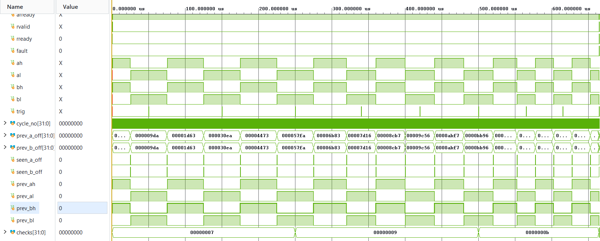

## Informe técnico — Proyecto 4:Control de corriente en un inversor monofasico mediante un regulador PR discreto sobre MicroBlaze V

Curso: EL3313 Taller de Diseño Digital
Semestre: II Semestre 2026
Proyecto:Control de corriente en un inversor monofasico ymediante un regulador PR discreto sobre MicroBlaze V
Plataforma FPGA: Digilent Basys 3


## Resumen

El proyecto consiste en el desarrollo de un sistema digital embebido basado en MicroBlaze V sobre una FPGA Basys 3, destinado al control de corriente de un inversor monofásico mediante un regulador PR discreto. La arquitectura emplea interfaces AXI4-Lite para integrar periféricos de temporización, adquisición de datos, generación PWM y comunicación UART. Se configuró y validó el sistema base en Vivado y Vitis, comprobando la ejecución de código C, la comunicación serial y el funcionamiento de las interrupciones periódicas del AXI Timer. Adicionalmente, se desarrolló un periférico PWM personalizado en SystemVerilog con su respectivo testbench y se incorporó el XADC al diseño de hardware. Estos avances establecen la base para completar la integración y verificar el funcionamiento del sistema de control.


## Introducción

El presente proyecto tiene como objetivo desarrollar un sistema digital embebido basado en el procesador MicroBlaze V, implementado sobre una FPGA Artix-7 de la tarjeta Basys 3. Este sistema está orientado al control de corriente de un inversor monofásico mediante un regulador proporcional-resonante (PR) discreto, integrando diferentes periféricos digitales para la adquisición de datos, la generación de señales de control y la comunicación con una computadora.

La arquitectura utiliza interfaces AXI4-Lite para establecer la comunicación entre el procesador y los periféricos. Entre sus componentes principales se encuentran el AXI Timer, encargado de establecer la base temporal mediante interrupciones periódicas; el ADC/XADC, destinado a la adquisición de muestras de corriente; el controlador PWM personalizado, desarrollado en SystemVerilog; y el AXI UART Lite, utilizado para transmitir información hacia una computadora. El software embebido se desarrolla en C mediante Vitis, mientras que la configuración e integración del hardware se realizan en Vivado.

Este informe presenta los fundamentos teóricos, las decisiones de diseño y la implementación de la plataforma digital. Asimismo, documenta las pruebas funcionales, los resultados de simulación y la verificación de los componentes desarrollados, con el propósito de evaluar el cumplimiento de los requisitos establecidos e identificar las principales limitaciones y oportunidades de mejora del sistema.


## Fundamentación teórica

Esta sección presenta los conceptos que sustentan el diseño digital del Proyecto 4: el procesador MicroBlaze V, el controlador PWM, la interfaz de adquisición ADC/XADC y el controlador UART. Cada apartado describe el concepto, su principio de funcionamiento y su relación con las decisiones del proyecto. Los valores marcados como *propuestos* están pendientes de validación con el componente de potencia (EL4201).

---

### 1. Procesador MicroBlaze V

#### 1.1 Concepto

MicroBlaze V es un procesador *soft-core*: no es un circuito fijo en el silicio, sino una descripción de hardware que se sintetiza en la lógica programable de la FPGA. Está basado en la arquitectura de conjunto de instrucciones (ISA) abierta RISC-V y está disponible en configuraciones de 32 y 64 bits [1], [2]. AMD lo incorporó al catálogo de Vivado desde la versión 2024.1 y es compatible a nivel de hardware con el MicroBlaze clásico [2], [3], lo que permite reutilizar la infraestructura de periféricos existente.

El uso de RISC-V permite aprovechar su ecosistema de herramientas de software, y la modularidad de la ISA permite elegir qué extensiones se implementan [1], [4]. La configuración de microcontrolador descrita por AMD es un núcleo de 32 bits con las extensiones RV32IMAFC [1]:

| Extensión | Aporte |
|---|---|
| I | Instrucciones enteras base |
| M | Multiplicación y división enteras |
| A | Operaciones atómicas |
| F | Punto flotante de precisión simple |
| C | Instrucciones comprimidas de 16 bits, que reducen el tamaño del código |


#### 1.2 Arquitectura y buses

El procesador sigue una arquitectura Harvard: tiene accesos separados para instrucciones y datos. En un sistema típico se distinguen dos tipos de interfaz:

- **Memoria local (LMB, *Local Memory Bus*):** conecta el procesador con bloques de BRAM mediante los buses ILMB (instrucciones) y DLMB (datos). Es de baja latencia y de tiempo de acceso fijo.
- **AXI4 / AXI4-Lite:** el procesador actúa como maestro y accede a los periféricos como si fueran posiciones de memoria (*memory-mapped I/O*). Cada periférico ocupa un rango de direcciones y expone sus registros en *offsets* relativos a su dirección base [5].

AXI4-Lite es un subconjunto simplificado de AXI4, con transferencias individuales y sin ráfagas. Organiza la comunicación en cinco canales independientes, cada uno con un protocolo de reconocimiento `VALID`/`READY` [5]:

| Canal | Función |
|---|---|
| AW | Dirección de escritura |
| W | Dato de escritura |
| B | Respuesta de escritura |
| AR | Dirección de lectura |
| R | Dato y respuesta de lectura |

Además, el módulo de depuración MDM (*MicroBlaze Debug Module*) permite programar, detener y depurar el procesador por JTAG desde Vitis [2].


#### 1.3 Flujo de diseño y modelo de programación

El diseño se divide en dos entornos:

1. **Vivado:** se construye el *Block Design* (procesador, memoria, interconexión y periféricos), se asignan las direcciones y se genera el *bitstream*. El resultado se exporta como un archivo de plataforma (XSA).
2. **Vitis:** se crea una plataforma a partir del XSA y se desarrolla la aplicación en C en modo *bare-metal*, es decir, sin sistema operativo. El *Board Support Package* (BSP) genera `xparameters.h` con las direcciones base y proporciona los controladores de cada IP.

Desde C, el acceso a un registro de periférico es una lectura o escritura en una dirección, por ejemplo mediante `Xil_In32` y `Xil_Out32` o los controladores de cada IP.


#### 1.4 Tiempo real y determinismo

Un lazo de control digital requiere que cada iteración ocurra a intervalos regulares y que el tiempo entre la medición y la actuación sea acotado. En un sistema *bare-metal* esto se logra con una **interrupción periódica**: un temporizador (AXI Timer) genera la interrupción, el controlador de interrupciones (AXI INTC) la entrega al procesador y la rutina de servicio (ISR) ejecuta siempre la misma secuencia de operaciones [11].

Dos factores afectan el determinismo:

- **Origen del código:** las instrucciones almacenadas en la memoria local tienen latencia fija, mientras que los accesos fuera de ella dependen de la caché y pueden variar por fallos de caché. Por eso conviene mantener el código del lazo en la BRAM local.
- **Aritmética del controlador:** con la extensión F, el cálculo en punto flotante se hace en hardware. Sin ella, se emula por software y consume muchos más ciclos. La alternativa es una implementación en punto fijo.

La ISR dispone de un presupuesto de tiempo acotado. Con un reloj de 100 MHz, un ciclo dura 10 ns. A una frecuencia de conmutación de 10 kHz, medio período equivale a 50 µs, es decir, 5 000 ciclos.


#### 1.5 Relación con el proyecto

| Parámetro | Valor requerido |
|---|---|
| Frecuencia de operación | 100 MHz |
| Caché de instrucciones | 8 KB |
| Memoria local | 32 KB de BRAM (programa, datos y búfer de muestras) |
| Interfaz de periféricos | AXI4-Lite |
| Depuración | MDM |
| Base de tiempo | AXI Timer con interrupción por AXI INTC |

MicroBlaze V ejecuta la ley de control PR y coordina los periféricos, mientras que las funciones que exigen precisión temporal (modulación, adquisición, comunicación serial) se delegan a hardware dedicado [12].

---

### 2. Controlador PWM

#### 2.1 Principio de la modulación por ancho de pulso

Un convertidor de potencia opera con interruptores que solo están en conducción o en corte. Para sintetizar una tensión de valor intermedio, se conmuta entre dos niveles con una frecuencia mucho mayor que la de la señal deseada, y se controla la fracción del período en la que la salida permanece en alto. Esta fracción es el ciclo de trabajo `D` y el valor medio de la salida es:

```
v̄ = (1/T) · ∫₀ᵀ v(t) dt = D · Vdc
```

La carga RL actúa como filtro pasa bajos para la corriente. Su función de transferencia entre tensión y corriente es:

```
G(s) = I(s) / V(s) = 1 / (L·s + R)
f_c    = R / (2π·L)
```

Si la frecuencia de conmutación es muy superior a `f_c`, la corriente sigue la tensión media y el rizado de conmutación queda atenuado [6], [7].


#### 2.2 Generación digital: portadora y comparador

En una implementación digital, la modulación se obtiene comparando una **portadora** (un contador) con una **referencia** (el valor deseado). La salida está en alto mientras la portadora es menor que la referencia.

- **Diente de sierra:** el contador sube y se reinicia. Los flancos de un lado coinciden siempre.
- **Triangular (simétrica):** el contador sube y baja. Los pulsos quedan centrados en el período, lo que reduce el contenido armónico y permite muestrear en un instante definido [7], [8].

La **resolución** depende de cuántas cuentas de reloj caben en un período, `N = f_clk / f_sw`, y su equivalente en bits es `log2(N)`. Con un reloj de 100 MHz:

| `f_sw` (propuesta) | Cuentas por período | Resolución aproximada |
|---|---:|---:|
| 10 kHz | 10 000 | 13,3 bits |
| 12,5 kHz | 8 000 | 13,0 bits |
| 20 kHz | 5 000 | 12,3 bits |

A mayor frecuencia de conmutación, menor rizado pero menor resolución y mayores pérdidas por conmutación.


#### 2.3 Puente H y modulación unipolar

El inversor en puente H tiene dos ramas (A y B), cada una con un transistor superior y uno inferior. Con la carga entre los puntos medios de las dos ramas, la tensión diferencial es `v_ab = v_A − v_B`. Hay dos esquemas de modulación [6], [7]:

| Esquema | Niveles de `v_ab` | Frecuencia aparente del rizado |
|---|---|---|
| Bipolar | `±Vdc` | `f_sw` |
| **Unipolar** | `+Vdc`, `0`, `−Vdc` | `2·f_sw` |

En la modulación unipolar las dos ramas se modulan con referencias complementarias, comparadas con la misma portadora triangular:

```
d_A  = (1 + m) / 2
d_B  = (1 − m) / 2
v̄_ab = Vdc · (d_A − d_B) = m · Vdc
```

donde `m ∈ [−1, 1]` es el índice de modulación. Como `d_A + d_B = 1`, para `m > 0` solo aparecen los niveles `+Vdc` y `0`, y para `m < 0` solo `−Vdc` y `0`.

Las cuatro combinaciones de las dos ramas son:

| Rama A | Rama B | `v_ab` |
|---|---|---|
| Superior | Superior | 0 |
| Inferior | Inferior | 0 |
| Superior | Inferior | `+Vdc` |
| Inferior | Superior | `−Vdc` |

Como cada pulso de `v_ab` ocurre al doble de la frecuencia de conmutación de cada transistor, el sistema se comporta, desde el punto de vista del rizado, como un convertidor reductor con frecuencia `2·f_sw`. Despreciando `R`, el rizado pico a pico de la corriente se estima como:

```
Δi_pp     ≈ Vdc · |m| · (1 − |m|) / (2 · f_sw · L)
Δi_pp,máx = Vdc / (8 · f_sw · L)        (con |m| = 0,5)
```

A modo de ilustración, para cumplir un rizado máximo de 0,20 A con `Vdc = 24 V` y `f_sw = 10 kHz`, esta estimación exige `L ≳ 1,5 mH`. La selección definitiva de `L` y de `f_sw` corresponde a EL4201.


#### 2.4 Tiempo muerto

Los transistores no conmutan instantáneamente. Si el inferior se enciende antes de que el superior termine de apagarse, ambos conducen a la vez y cortocircuitan la fuente (*shoot-through*). Para evitarlo se inserta un **tiempo muerto** `t_d`: al cambiar de estado, ambos transistores de la rama permanecen apagados durante ese intervalo [6], [7].

El tiempo muerto tiene un costo: introduce un error de tensión que depende del sentido de la corriente, pues durante ese intervalo la rama queda determinada por el diodo del transistor que conduce la corriente. Como orden de magnitud, el error en la tensión diferencial puede alcanzar:

```
ΔV ≈ 2 · Vdc · t_d · f_sw
```

Por ejemplo, con `Vdc = 24 V`, `t_d = 210 ns` y `f_sw = 10 kHz` resulta aproximadamente 0,10 V. Este error distorsiona la corriente, en particular cerca de sus cruces por cero, y puede compensarse en el controlador. Además, un pulso más corto que el tiempo muerto no puede generarse, lo que limita el ciclo de trabajo cerca de 0 % y 100 %.

En el diseño propuesto, el tiempo muerto es programable de 1 a 100 ciclos de reloj, con valor inicial de 20. El tiempo efectivo es de aproximadamente `(D+1)` ciclos de 10 ns.


#### 2.5 Interfaz AXI4-Lite y registros

El controlador PWM es un esclavo AXI4-Lite. El software lo configura escribiendo registros mapeados en memoria [5]:

| Offset | Registro | Contenido |
|---|---|---|
| `0x00` | CONTROL | `enable`, `freq_sel` y `running` (solo lectura) |
| `0x04` | DUTY | Referencia `m` con signo en formato Q1.15 |
| `0x08` | DEADTIME | Tiempo muerto en ciclos de reloj |
| `0x0C` | STATUS | Falla enclavada y estado de `fault_i` |

Tres principios de diseño sustentan esta interfaz:

- **Formato Q1.15:** representa `m` como un entero de 16 bits con signo; el valor real es el entero dividido entre `2^15`, con rango `[−1, 1)`. El software convierte la salida del controlador PR a este formato.
- **Saturación:** toda escritura fuera del rango admisible se limita al valor válido más cercano. Así el software no puede forzar una modulación inválida.
- **Registro sombra:** la referencia, el período y el tiempo muerto escritos por el software se copian a registros activos solo al final de cada período de la portadora. Si cambiaran en medio del período, aparecerían pulsos cortados o duplicados.


#### 2.6 Sincronización con la adquisición

En una modulación simétrica, el valor medio de la corriente en un período coincide con su valor en el centro del período, es decir, en el pico y el valle de la portadora. Muestrear en ese instante evita que el rizado de conmutación contamine la medida (*aliasing* del rizado) [8]. Por eso el controlador emite una señal `pwm_trigger_o` una vez por período, en el pico de la portadora, que dispara la conversión del ADC.

El orden temporal es: muestreo en el pico, cálculo del control en el procesador y aplicación del nuevo valor al inicio del siguiente período. Estos retardos (de cómputo y de actualización del modulador) deben incluirse en el análisis de estabilidad del lazo, lo que corresponde al componente de control de EL4201.


#### 2.7 Relación con el proyecto

| Aspecto | Valor propuesto |
|---|---|
| Frecuencias de conmutación | 10, 12,5 y 20 kHz |
| Modulación | Unipolar con portadora triangular |
| Referencia | Q1.15 con signo y saturación |
| Tiempo muerto | Programable de 1 a 100 ciclos |
| Sincronización | `pwm_trigger_o` en el pico de la portadora |
| Protección | `fault_i` apaga las cuatro compuertas de inmediato |

El enunciado exige que este módulo sea personalizado y en SystemVerilog, porque no existe una IP de AMD que implemente directamente esta modulación con tiempo muerto [12].

---

### 3. Interfaz ADC/XADC

#### 3.1 Concepto

El XADC es un convertidor analógico-digital integrado en las FPGA de la serie 7 de AMD. Contiene dos ADC de 12 bits que alcanzan 1 MSPS, además de sensores internos de temperatura y tensión [9]. Las entradas externas son diferenciales. Las 16 entradas auxiliares (`VAUXP[15:0]` y `VAUXN[15:0]`) comparten los pines físicos con las E/S digitales [9].


#### 3.2 Rango de entrada y resolución

En modo unipolar, la entrada diferencial admite de 0 V a 1,0 V, y la tensión en `VP` respecto a `VN` debe ser siempre positiva [9]. Con 12 bits, el escalón de cuantización es:

```
LSB = 1 V / 2^12 ≈ 244 µV
```

El resultado de cada conversión se almacena en un registro de 16 bits, justificado hacia el bit más significativo, de modo que el dato de 12 bits ocupa los bits `[15:4]` [9].


#### 3.3 Acondicionamiento de la corriente

Como el XADC solo acepta tensiones positivas de 0 a 1 V, y la corriente del inversor es alterna, la señal del sensor debe adaptarse con un desplazamiento y una ganancia:

```
v_adc = V_off + k · i
i     = (v_adc − V_off) / k
```

donde `V_off` coloca el cero de corriente en el centro del rango (propuesto 0,5 V) y `k` (V/A) se elige para que el pico de 1,0 A, con margen, no sature el rango. La resolución en corriente es `LSB / k`. Estos valores los define EL4201 junto con el filtro antialias del sensor.


#### 3.4 Modos de muestreo

El XADC tiene dos modos de temporización [9]:

| Modo | Disparo del muestreo |
|---|---|
| Continuo | La conversión se repite sin intervención externa. |
| **Orientado a eventos** | La entrada `CONVST` fija el instante de muestreo y de inicio de la conversión. |

El modo orientado a eventos se usa cuando se necesita control preciso del instante de muestreo [9]. En este proyecto, `CONVST` se conecta a `pwm_trigger_o`, de modo que cada conversión queda alineada con el centro del período de conmutación. Una conversión completa dura aproximadamente 26 ciclos del reloj del ADC, es decir, cerca de 1 µs a 26 MHz, un tiempo mucho menor que el período del PWM.


#### 3.5 Acceso desde el procesador

El XADC se configura y se lee por el puerto de reconfiguración dinámica (DRP), un bus de registros de 7 bits de dirección [9]. En Vivado, el asistente *XADC Wizard* genera una IP con interfaz AXI4-Lite que expone esos registros al procesador. Los resultados de los canales auxiliares ocupan las direcciones `10h` a `1Fh` del espacio DRP [9]. El software lee el dato, lo desplaza 4 bits y lo convierte a amperios con la relación de la sección 3.3.


#### 3.6 Relación con el proyecto

| Aspecto | Decisión |
|---|---|
| Modo de muestreo | Orientado a eventos, disparado por `pwm_trigger_o` |
| Interfaz | XADC Wizard con AXI4-Lite |
| Entrada | Un canal auxiliar, unipolar, de 0 a 1 V |
| Instante de muestreo | Pico de la portadora (una muestra por período) |
| Resolución | 12 bits (≈ 244 µV por escalón) |

---

### 4. Controlador UART

#### 4.1 Concepto

La UART (*Universal Asynchronous Receiver/Transmitter*) es un enlace serial asíncrono: no comparte una señal de reloj entre emisor y receptor. Ambos acuerdan de antemano la velocidad (baudios) y el formato de cada carácter [10].


#### 4.2 Formato de la trama

Cada carácter se transmite en una trama:

| Campo | Descripción |
|---|---|
| Reposo | La línea permanece en nivel alto. |
| Bit de inicio | Un bit en nivel bajo que marca el comienzo. |
| Datos | De 5 a 8 bits, comenzando por el menos significativo. |
| Paridad | Opcional (par, impar o ninguna). |
| Bit de parada | Un bit en nivel alto. |

El formato más común es 8N1: 8 bits de datos, sin paridad y 1 bit de parada, es decir, 10 bits por carácter. A una velocidad de `B` baudios, la tasa efectiva y el tiempo por carácter son:

```
tasa efectiva = B / 10  caracteres/s
t_car         = 10 / B
```

Para 115 200 baudios: 11 520 caracteres por segundo, es decir, unos 86,8 µs por carácter.


#### 4.3 El IP AXI UART Lite

El AXI UART Lite es un controlador de UART con interfaz AXI4-Lite. Sus características principales son [10]:

- Transmisión y recepción independientes (*full duplex*).
- Caracteres de 5 a 8 bits, con un bit de parada y paridad par, impar o sin paridad.
- Velocidad configurable (se fija al configurar el IP).
- FIFO de 16 caracteres para transmisión y para recepción.
- Generador de velocidad (BRG) y control de interrupciones.

El procesador accede a sus registros mapeados en memoria: la FIFO de recepción, la FIFO de transmisión, el registro de estado (que indica, por ejemplo, si la FIFO de transmisión está llena) y el registro de control, que permite habilitar interrupciones y limpiar las FIFO [10].


#### 4.4 Consideraciones de tiempo en el proyecto

La exportación de `N` muestras con `B_m` caracteres por muestra tarda:

```
t_exp = 10 · N · B_m / B
```

Por ejemplo, 1 000 muestras en texto de 6 caracteres a 115 200 baudios requieren unos 0,52 s. Dos consecuencias de diseño son relevantes:

1. **La FIFO de 16 caracteres** se vacía en unos 1,4 ms a esta velocidad, por lo que el software no puede enviar datos más rápido que el enlace.
2. **Un carácter dura 86,8 µs**, un tiempo comparable con el período de control (100 µs a 10 kHz). Por eso la exportación no debe ejecutarse dentro de la ISR del lazo, sino en el programa principal o por interrupción, de modo que la transmisión no afecte la periodicidad del control.


#### 4.5 Relación con el proyecto

| Aspecto | Decisión |
|---|---|
| IP | AXI UART Lite |
| Formato | 8N1 a 115 200 baudios (propuesto) |
| Función | Enviar a la PC el historial de muestras al pulsar un botón |
| Ubicación del envío | Programa principal, fuera de la ISR del lazo |
| Almacenamiento | Búfer circular en la BRAM local |

---


## Enfoque de la solución y justificación del diseño

La solución se basa en una arquitectura modular que combina un procesador MicroBlaze V con periféricos digitales conectados mediante AXI4-Lite. Esta organización permite ejecutar las tareas de procesamiento en software y delegar al hardware las operaciones que requieren temporización precisa, como la generación PWM y la adquisición de datos.

Para el desarrollo se establecieron las siguientes decisiones de diseño:

| Componente | Decisión y justificación |
|---|---|
| MicroBlaze V | Se utiliza a 100 MHz, con 32 KB de memoria local y 8 KB de caché de instrucciones, cumpliendo los requisitos de procesamiento del proyecto. |
| AXI4-Lite | Permite acceder a los periféricos mediante registros mapeados en memoria, facilitando su configuración desde C. |
| AXI Timer | Se utiliza para generar interrupciones periódicas, proporcionando una base temporal independiente del ciclo principal del programa. |
| PWM personalizado | Se desarrolla en SystemVerilog para generar modulación unipolar, seleccionar frecuencias y aplicar tiempo muerto directamente en hardware. |
| ADC/XADC | Se utiliza el XADC integrado en la FPGA, configurado para adquirir datos mediante el canal VAUX6. |
| AXI UART Lite | Se aprovecha la IP disponible en Vivado para establecer comunicación serial con una computadora. |

La implementación se desarrolla de manera incremental, verificando primero el funcionamiento del procesador, la comunicación UART y las interrupciones del temporizador. Posteriormente se incorporan los periféricos de adquisición y actuación para completar el lazo de control.

Esta metodología facilita la identificación de errores, permite comprobar cada componente de forma independiente y simplifica la integración del sistema.


### Inversor monofasico


## Resultados

### Validación del periférico PWM mediante simulación Tcl en Vivado

Para validar el módulo PWM con interfaz AXI-Lite (`pwm_axi_lite.sv`) sin depender de la interfaz gráfica ni generar archivos residuales dentro del repositorio, se ejecutó una simulación comportamental en **Vivado 2026.1** utilizando la consola Tcl mediante los siguientes pasos:

#### 1. Creación de un proyecto temporal
Se generó un proyecto limpio dentro de la carpeta temporal del sistema operativo (`%TEMP%`) con marca de tiempo única, apuntando al dispositivo objetivo (`xc7a35tcpg236-1`):

```tcl
set simdir [file join $env(TEMP) "pwm_tb_sim_[clock seconds]"]
create_project pwm_tb_sim $simdir -part xc7a35tcpg236-1
```

#### 2. Carga de fuentes y definición del *Top Module*
Se asignaron las rutas del diseño RTL (`pwm_axi_lite.sv`) y del *testbench* (`tb_pwm_axi_lite.sv`), verificando su existencia en disco, agregándolos al conjunto de simulación (`sim_1`) y estableciendo el *testbench* como módulo principal:

```tcl
set rtl {C:\Users\User\Documents\GitHub\EL3313-Proyecto-4\archivos-vivado\pwm\pwm_axi_lite.sv}
set tb  {C:\Users\User\Documents\GitHub\EL3313-Proyecto-4\archivos-vivado\pwm\tb_pwm_axi_lite.sv}

add_files -fileset sim_1 -norecurse [list $rtl $tb]
set_property top tb_pwm_axi_lite [get_filesets sim_1]
update_compile_order -fileset sim_1
```

#### 3. Compilación, elaboración y ejecución (XSim)
Se lanzó la simulación comportamental (`launch_simulation`), proceso en el cual Vivado compiló (`xvlog`) los módulos `pwm_axi_lite`, `deadtime_leg` y `tb_pwm_axi_lite`, elaboró el *snapshot* (`xelab`) y ejecutó los primeros `1000 ns` por defecto. Posteriormente, se corrió la simulación completa hasta encontrar la instrucción `$finish`:

```tcl
launch_simulation -simset sim_1 -mode behavioral
run all
```

#### 4. Resultados de la verificación
La simulación finalizó exitosamente en `665530 ns` superando todas las aserciones del *testbench*:

* **Validación de frecuencias de salida:**
  * Periodo de `10000` ciclos -> `10.0 kHz` (**PASS**)
  * Periodo de `8000` ciclos -> `12.5 kHz` (**PASS**)
  * Periodo de `5000` ciclos -> `20.0 kHz` (**PASS**)
* **Integridad y tiempos muertos:** Se completaron **18 operaciones/verificaciones** de lectura/escritura AXI-Lite y conmutación sin detectar condiciones de *shoot-through*.


## Analisis e interpretacion de resultados

Las Figuras 1 y 2 muestran la vista general de la simulación comportamental del periférico PWM. La primera captura agrupa el reloj, el reset y las transacciones AXI4-Lite; la segunda presenta la falla, las cuatro salidas de compuerta, el disparo `trig` y las señales del monitor del *testbench*.

En la Figura 1 se observa que el registro de control, dirección `0x00`, recibe los valores `0x00000001`, `0x00000003` y `0x00000005`. Estos corresponden a habilitar el PWM y seleccionar, en secuencia, los tres casos de frecuencia probados. Las respuestas AXI muestran `OKAY` (`0`) y la lectura de control devuelve `0x00000009`: `running` y `enable` activos con el selector de frecuencia en `00`. Esto es consistente con la secuencia de configuración del *testbench*.

En la Figura 2, `ah/al` y `bh/bl` conmutan en pares complementarios. El disparo `trig` aparece una vez por período; al cambiar la selección de frecuencia, los intervalos entre disparos se reducen, de acuerdo con los períodos de 100, 80 y 50 microsegundos (10, 12,5 y 20 kHz). La entrada `fault` permanece inactiva en el tramo mostrado. La referencia usada en la prueba se fija en cero antes de habilitar el PWM, por lo que las dos ramas muestran patrones coincidentes.

En el instante inicial de las capturas, algunos valores se muestran como `X`. Esto corresponde al estado previo a que el reset síncrono sea muestreado por el primer flanco de reloj; no significa que las señales permanezcan indefinidas durante la operación. Después de la inicialización se observan valores definidos y la simulación concluye con los mensajes `PASS` del *testbench*.

Las figuras son vistas generales y su escala de cientos de microsegundos no permite resolver visualmente el tiempo muerto, programado en cinco ciclos (50 ns a 100 MHz) en la prueba. El valor activo se actualiza al límite de período. La comprobación de ausencia de *shoot-through* y del intervalo mínimo se respalda en las aserciones del *testbench*, no en la resolución de estas capturas. En conjunto con los períodos medidos de 10 000, 8 000 y 5 000 ciclos y las 18 operaciones/verificaciones reportadas, los resultados validan el comportamiento funcional cubierto para el periférico aislado; no verifican su integración con MicroBlaze, XADC, AXI Timer ni el inversor físico.

**Figura 1.** Transacciones AXI4-Lite durante la prueba del periferico PWM.


**Figura 2.** Salidas de compuerta, disparo PWM y señales del monitor del *testbench*.



## Conclusiones y aprendizaje obtenido